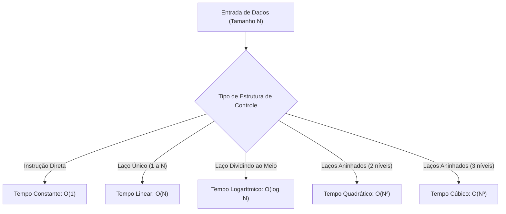

# 📘 UA01: Modelos de Computação e Eficiência de Algoritmos

> [!abstract] **Objetivos de Aprendizagem (SAGAH)**
> - Definir complexidade temporal e complexidade de espaço em algoritmos computacionais.
> - Desenvolver e aplicar um modelo de contagem genérico para estimativa de eficiência.
> - Explicar a contagem na análise de eficiência de algoritmos nas situações de melhor caso, caso médio e pior caso.

---

## 📌 1. Introdução e Contextualização

A análise de algoritmos é o ramo da ciência da computação dedicado a determinar teoricamente a quantidade de recursos necessários para a execução de um programa. Ao avaliar uma solução, não se mede o tempo de execução em segundos ou milissegundos através de um cronômetro, pois esse valor varia de acordo com a velocidade da CPU, a memória RAM, o sistema operacional e a linguagem utilizada.

Em vez disso, a eficiência de um algoritmo é avaliada matematicamente pelo seu **comportamento assintótico**: como a quantidade de operações elementares e a memória consumida crescem à medida que o tamanho da entrada de dados ($N$) tende ao infinito.

> **Princípio-Chave:** Um algoritmo eficiente é aquele cujo consumo de tempo e de espaço de memória escala de maneira sustentável e previsível diante do crescimento do volume de dados de entrada.

---

## 🧬 2. Núcleo Conceitual (O "Como" e o "Porquê")

### ⏱️ Complexidade Temporal vs. 💾 Complexidade Espacial
A análise algorítmica decompõe o consumo de recursos em duas dimensões fundamentais:

* **Complexidade Temporal:** Quantidade de passos ou operações elementares (somas, comparações, atribuições) que o algoritmo executa até atingir a condição de parada.
* **Complexidade Espacial:** Volume de memória adicional (além dos dados de entrada) exigido para armazenar variáveis, estruturas auxiliares, ponteiros e a pilha de recursão.

### 🧮 O Modelo de Contagem Genérico
Para evitar medições dependentes de hardware, adota-se um **modelo de máquina genérico (RAM - Random Access Machine)**, onde:
1. Cada operação simples (atribuição, teste lógico, operação aritmética) consome **tempo constante $O(1)$**.
2. Laços sequenciais executados $N$ vezes geram custo proporcional a $N$.
3. Laços aninhados multiplicam o número de passos ($N \times N = N^2$).
4. Ignoram-se constantes multiplicativas e termos de menor grau, mantendo apenas o termo dominante que comanda a taxa de crescimento.

### 🎲 Cenários de Entrada: Melhor, Médio e Pior Caso
O desempenho de um algoritmo depende frequentemente da ordenação ou da distribuição prévia dos dados de entrada:

- **Melhor Caso ($\Omega$ - Ômega):** Cenário ideal de menor esforço computacional (ex.: buscar um elemento em um vetor e encontrá-lo logo na primeira posição testada).
- **Caso Médio ($\Theta$ - Teta):** Comportamento estatístico esperado considerando entradas aleatórias distribuídas uniformemente.
- **Pior Caso ($O$ - Big-O):** Limite superior do tempo de execução; a garantia teórica de que o algoritmo nunca levará mais passos do que essa cota (ex.: o elemento buscado está na última posição ou não existe no vetor).

### 📖 Analogia Feynman: Encontrando uma Palavra no Dicionário
> Imagine procurar o nome "Zulmira" em uma lista telefônica ou dicionário:
> - **Abordagem Linear $O(N)$ (Força Bruta):** Ler página por página desde a letra A até a letra Z. Se a lista tiver 1 milhão de nomes, você fará 1 milhão de comparações.
> - **Abordagem Logarítmica $O(\log N)$ (Busca Binária):** Abrir o dicionário exatamente no meio. Se "Z" vem depois, descarte a primeira metade inteira e repita a divisão na metade restante. Em uma base de 1 milhão de nomes, a busca binária encontra o registro em apenas **20 passos**!
>
> A análise assintótica não mede a velocidade do dedo que folheia o papel, mas o método utilizado para eliminar trabalho desnecessário.

---

## 📊 3. Síntese Comparativa de Classes de Complexidade

| Notação | Nome da Classe | Crescimento para $N = 10$ | Crescimento para $N = 100$ | Crescimento para $N = 1.000$ | Exemplo Clássico |
| :--- | :--- | :--- | :--- | :--- | :--- |
| **$O(1)$** | Constante | 1 op | 1 op | 1 op | Acesso a índice de vetor (`vetor[i]`) |
| **$O(\log N)$** | Logarítmica | ~3 op | ~7 op | ~10 op | Busca binária em vetor ordenado |
| **$O(N)$** | Linear | 10 op | 100 op | 1.000 op | Busca sequencial simples |
| **$O(N \log N)$** | Linearítmica | ~33 op | ~664 op | ~9.966 op | Algoritmos eficientes de ordenação (*Merge Sort*, *Quick Sort*) |
| **$O(N^2)$** | Quadrática | 100 op | 10.000 op | 1.000.000 op | *Bubble Sort*, laços duplos aninhados |
| **$O(N^3)$** | Cúbica | 1.000 op | 1.000.000 op | 1.000.000.000 op | Multiplicação tradicional de matrizes |
| **$O(2^N)$** | Exponencial | 1.024 op | $1,26 \times 10^{30}$ op | Inviável | Problema do Caixeiro Viajante (Força Bruta) |

---

## 🚀 4. Aplicação Prática: O Desafio SAEB (Análise de Big Data)

No estudo de caso com a base de dados do Sistema de Avaliação da Educação Básica (SAEB), contendo milhões de registros de estudantes, avaliou-se três soluções algorítmicas sob condições de 95% de filtragem e 5% de cálculo estatístico:

* **Solução A:** Filtro $O(N)$ + Cálculo estatístico quadrático $O(N^2)$ ➔ **Inviável**: Para $N = 5.000.000$, $N^2$ resulta em $2,5 \times 10^{13}$ operações, paralisando a infraestrutura.
* **Solução B:** Filtro linear $O(N)$ + Cálculo linear $O(N)$ com memória constante $O(1)$ ➔ **Ideal**: Tempo médio ponderado $0{,}95 \cdot O(N) + 0{,}05 \cdot O(N) = O(N)$, garantindo rapidez e imunidade a estouro de memória (*Out of Memory*).
* **Solução C:** Filtro linear $O(N)$ + Cálculo linear $O(N)$, porém consumindo memória proporcional $O(N)$ ➔ **Subótima**: Risco de falha de alocação de memória para bases em larga escala.

---

## 🎯 5. Dica do Professor (Foco em Provas)

> [!tip] **O que mais costuma cair em avaliações:**
> 1. **Hierarquia de Eficiência:** Memorize a ordem: $O(1) < O(\log N) < O(N) < O(N \log N) < O(N^2) < O(N^3) < O(2^N)$. Em eficiência, quanto menor o expoente, melhor o algoritmo.
> 2. **Multiplicação de Matrizes:** A multiplicação padrão de duas matrizes $N \times N$ utiliza três laços aninhados independentes (linhas, colunas e somatório de produtos), resultando sempre em complexidade **$O(N^3)$**.
> 3. **Divisão Sucessiva por 2:** Todo algoritmo que a cada iteração reduz o tamanho restante do problema pela metade (como a busca binária) possui complexidade temporal **$O(\log N)$**.
> 4. **Economia de Espaço:** Um algoritmo com complexidade espacial $O(1)$ utiliza apenas um número fixo de variáveis auxiliares, sendo muito superior em economia de memória a algoritmos que alocam $O(N)$.

---

## 🧠 6. Questões de Fixação (Active Recall & SAGAH)

> **P1: A operação de multiplicação de matrizes é base de muitos solucionadores de equações diferenciais e simuladores de fenômenos físicos. Geralmente, essa operação é implementada por um algoritmo que tem três laços aninhados de execução. Sabendo que, dentro desses laços, existem apenas operações de tempo constante, qual é a complexidade de tempo da multiplicação de matrizes implementada dessa maneira?**  
> **Resposta Correta:** **a) $N^3$.**  
> 🎯 **Por quê?** Cada laço executa $N$ iterações. Como os três laços estão aninhados um dentro do outro, a quantidade total de operações elementares é proporcional a $N \times N \times N = N^3$.

---

> **P2: A ordenação de vetores é um dos problemas mais estudados em computação. Diversas soluções têm complexidade de tempo semelhante, e o que as diferencia é, principalmente, a complexidade de espaço. Sabendo que existe limitação de espaço para sua execução, qual das complexidades de espaço elencadas a seguir é a mais eficiente?**  
> **Resposta Correta:** **a) 1.**  
> 🎯 **Por quê?** A complexidade espacial $O(1)$ representa consumo de memória constante. Isso significa que o algoritmo utiliza apenas uma quantidade fixa de variáveis locais, independentemente de o vetor possuir 10 ou 10 milhões de elementos.

---

> **P3: Ao longo do tempo, diversas soluções para problemas conhecidos foram propostas. Sabendo que todas as soluções para um problema têm a mesma qualidade de resultado, qual das complexidades elencadas a seguir indica a solução com melhor eficiência de tempo?**  
> **Resposta Correta:** **a) $\log N$.**  
> 🎯 **Por quê?** Entre as opções apresentadas ($\log N$, $N$, $N \log N$, $N^2$ e $N^3$), a função logarítmica é a que apresenta a menor taxa de crescimento quando $N$ aumenta, demandando o menor número de operações.

---

> **P4: Existe uma solução para a busca de elementos em um vetor que assume que existe um vetor já ordenado e realiza uma busca guiada nele, de maneira que, a cada iteração, metade do vetor restante é ignorada, buscando o elemento desejado apenas na outra metade. Qual é a complexidade de tempo de soluções desse tipo?**  
> **Resposta Correta:** **e) $\log N$.**  
> 🎯 **Por quê?** Este é o funcionamento exato da Busca Binária. Ao dividir o espaço de busca pela metade a cada passo, a relação de recorrência é $T(N) = T(N/2) + O(1)$, cuja solução assintótica é estritamente $O(\log N)$.

---

## 📚 7. Referências e Conexões

- **CORMEN, T. H. et al.** *Algoritmos: teoria e prática*. 3. ed. Rio de Janeiro: Elsevier, 2012.
- **SEDGEWICK, R.; WAYNE, K.** *Algorithms*. 4. ed. Boston: Addison-Wesley, 2011.
- Plataforma SAGAH: Unidade de Aprendizagem *Modelos de Computação e Eficiência de Algoritmos*.
- [[UA02 - Divisão e Conquista em Programação Paralela]]
- [[UA03 - Métodos de Ordenação Interna de Dados]]
