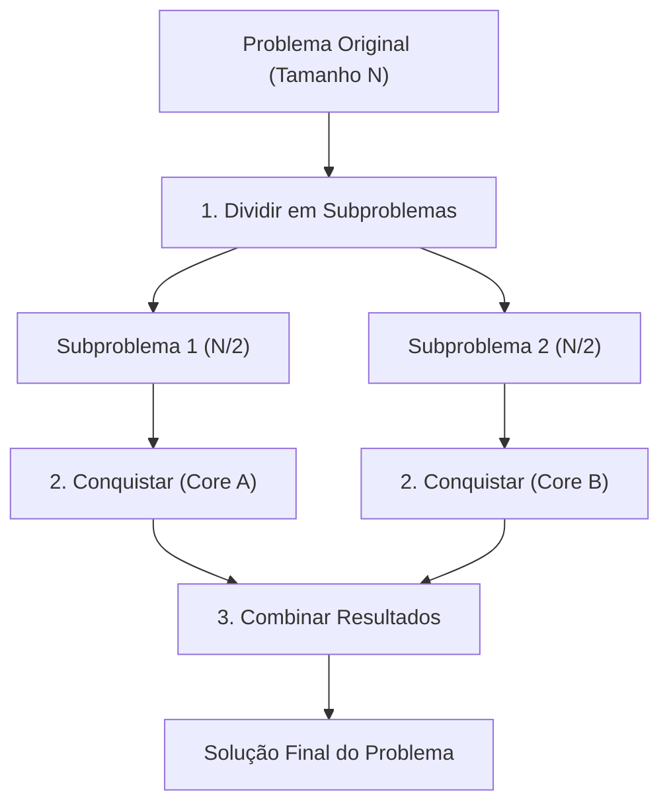

# 📘 UA02: Divisão e Conquista em Programação Paralela

> [!abstract] **Objetivos de Aprendizagem (SAGAH)**
> - Conceituar o paradigma de divisão e conquista no contexto da programação paralela e concorrente.
> - Descrever os métodos estruturais de divisão e conquista de acordo com a literatura (Hardwick, 1997).
> - Identificar casos de uso práticos e diferenciar a divisão e conquista da programação dinâmica.

---

## 📌 1. Introdução e Contextualização

Com o limite físico das frequências de clock dos processadores modernos (*Power Wall*), o ganho de desempenho computacional passou a depender da proliferação de múltiplos núcleos (*multicore*) e nós de processamento distribuído. Nesse cenário, o modelo sequencial tradicional torna-se um gargalo, exigindo **programação paralela**: a capacidade de decompor uma grande tarefa em partes menores executadas simultaneamente em processadores distintos.

O paradigma de **Divisão e Conquista (*Divide-and-Conquer*)** é o modelo de projeto de algoritmos mais consagrado para arquiteturas paralelas, pois sua estrutura recursiva natural permite atribuir ramos independentes de execução a diferentes threads ou núcleos de processamento.

> **Princípio-Chave:** Divisão e conquista soluciona um problema complexo particionando-o recursivamente em subproblemas menores e independentes, resolvendo cada um em paralelo e combinando seus resultados parciais para formar a resposta global.

---

## 🧬 2. Núcleo Conceitual (O "Como" e o "Porquê")

### 🔄 As Três Etapas Universais do Paradigma
Qualquer algoritmo de divisão e conquista opera rigorosamente em três fases consecutivas:

1. **Dividir:** Particionar o problema original em instâncias menores (subproblemas) da mesma natureza.
2. **Conquistar:** Resolver os subproblemas de forma recursiva. Quando o tamanho do subproblema atinge a condição base (*tamanho mínimo*), ele é resolvido diretamente por uma operação elementar.
3. **Combinar:** Unir as soluções parciais dos subproblemas para sintetizar a solução final do problema original.



### 🧩 As Dimensões de Hardwick (1997) na Computação Paralela
Para implementar divisão e conquista em hardware paralelo, Hardwick (1997) estabelece critérios de caracterização técnica:

* **Fator de Ramificação:** O número de subproblemas gerados a cada etapa da divisão (ex.: grau binário = 2 subproblemas).
* **Equilíbrio (Balanceamento de Carga):** Se os subproblemas têm o mesmo tamanho computacional, a carga de trabalho entre os núcleos é uniforme, evitando que uma CPU fique ociosa esperando outra finalizar.
* **Divisibilidade Embaraçosa (*Embarrassingly Parallel*):** Situação ideal onde o problema pode ser dividido instantaneamente sem comunicação ou movimento extra de dados entre as CPUs.
* **Dependência de Dados da Função de Combinar:** O grau em que a etapa de fusão exige troca de mensagens e sincronização entre os processadores.
* **Dependência de Dados da Função de Tamanho:** Quando o volume dos subproblemas depende dos valores de entrada, permitindo descartar intervalos inteiros com base nos dados (como na busca binária).
* **Paralelismo de Controle vs. Paralelismo de Dados:** Controle refere-se a threads executando fluxos independentes; dados refere-se à mesma instrução aplicada sobre grandes matrizes particionadas (SIMD).

---

## 📊 3. Síntese Comparativa: Divisão e Conquista vs. Programação Dinâmica

Uma confusão clássica em ciência da computação ocorre entre Divisão e Conquista e Programação Dinâmica, pois ambas decompõem o problema em partes menores:

| Critério de Comparação | Divisão e Conquista | Programação Dinâmica |
| :--- | :--- | :--- |
| **Relação entre Subproblemas** | **Independentes e Disjuntos:** Os subproblemas não se sobrepõem; cada um é único. | **Sobrepostos (*Overlapping*):** Os mesmos subproblemas são chamados e recalculados repetidamente. |
| **Estratégia de Resolução** | *Top-Down* (recursão pura dividindo até o caso base). | *Bottom-Up* com tabelamento ou *Top-Down* com **Memoização**. |
| **Armazenamento de Memória** | Pilha de chamadas da recursão; não armazena histórico. | Tabela ou cache (vetor/matriz) para reaproveitar cálculos passados. |
| **Exemplo Clássico** | Busca Binária, *Merge Sort*, *Quick Sort*. | Sequência de Fibonacci, Problema da Mochila (*Knapsack*), Algoritmo de Floyd-Warshall. |

> [!tip] **Regra Prática de Identificação:**
> Se o problema descarta ou resolve partes sem nunca precisar consultar uma resposta calculada anteriormente (como na busca binária), utilize **Divisão e Conquista**. Se ele precisa somar ou comparar soluções de estados anteriores já explorados, aplique **Programação Dinâmica**.

---

## 🚀 4. Aplicação Prática: Mínimo e Máximo em Paralelo

Considere o problema de encontrar simultaneamente o menor e o maior elemento de uma grande matriz. Uma abordagem sequencial de força bruta percorreria todos os elementos individualmente em $2(N - 1)$ comparações.

Aplicando Divisão e Conquista em Python:
```python
def min_max_divisao_conquista(vetor, inicio, fim):
    # Caso Base 1: Apenas 1 elemento
    if inicio == fim:
        return vetor[inicio], vetor[inicio]
    
    # Caso Base 2: Apenas 2 elementos
    if fim == inicio + 1:
        if vetor[inicio] < vetor[fim]:
            return vetor[inicio], vetor[fim]
        else:
            return vetor[fim], vetor[inicio]
            
    # 1. Dividir: calcula o ponto médio
    meio = (inicio + fim) // 2
    
    # 2. Conquistar: executa recursivamente em cada metade (potencial paralelo)
    min_esq, max_esq = min_max_divisao_conquista(vetor, inicio, meio)
    min_dir, max_dir = min_max_divisao_conquista(vetor, meio + 1, fim)
    
    # 3. Combinar: compara apenas os extremos de cada ramo
    return min(min_esq, min_dir), max(max_esq, max_dir)
```
Essa abordagem reduz o número de comparações para $3N/2 - 2$ e permite que cada ramo seja disparado em uma thread ou núcleo independente.

---

## 🎯 5. Dica do Professor (Foco em Provas)

> [!tip] **O que mais costuma cair em avaliações:**
> 1. **A Ordem das Três Fases:** A sequência canônica é estritamente **Dividir ➔ Conquistar ➔ Combinar**. Inversões dessa ordem em testes de múltipla escolha são distratores.
> 2. **Afirmação sobre Complexidade da Programação Paralela:** A programação paralela é uma tarefa **complexa**, mas indispensável para projetos de alto desempenho. Afirmativas que a classificam como "simples" estão incorretas.
> 3. **Independência dos Subproblemas:** Em divisão e conquista, os subproblemas são instâncias menores e *independentes* do problema original, resolvidas pelo mesmo algoritmo.
> 4. **Métodos de Hardwick:** Memorize os métodos estruturais: fator de ramificação, equilíbrio, divisibilidade embaraçosa, dependência de dados na função de combinar e dependência de dados na função de tamanho.

---

## 🧠 6. Questões de Fixação (Active Recall & SAGAH)

> **P1: O termo programação paralela pode ser utilizado em conjunto com computação paralela. Ela é o processo que decompõe um problema em tarefas menores para execução simultânea. Analise as afirmativas:**  
> I. As tarefas podem ser executadas ao mesmo tempo em vários computadores ou núcleos.  
> II. É importante para grandes projetos que demandam velocidade e precisão.  
> III. Mesmo sendo uma tarefa complexa, permite realizar análises muito mais rápidas.  
> IV. A programação paralela é uma tarefa simples.  
> **Resposta Correta:** **b) I, II e III.**  
> 🎯 **Por quê?** A afirmativa IV é falsa porque o desenvolvimento paralelo envolve desafios intrínsecos de alta complexidade técnica, como condições de corrida (*race conditions*), impasses (*deadlocks*) e necessidade de sincronização e balanceamento de carga entre processadores.

---

> **P2: Hardwick (1997) afirma que o método de divisão e conquista é a técnica mais conhecida de projetos de algoritmos. Assinale a alternativa correta:**  
> **Resposta Correta:** **e) Dividir e conquistar pode ser considerada uma variante da técnica de programação de cima para baixo mais geral.**  
> 🎯 **Por quê?** O paradigma de dividir e conquistar parte do problema macro e o decompõe recursivamente em estruturas menores, configurando uma clássica abordagem *Top-Down* (de cima para baixo).

---

> **P3: Entre os modelos de aplicação da programação paralela, o mais comum é o divide-and-conquer. Esse algoritmo funciona seguindo um plano que ocorre na seguinte ordem:**  
> **Resposta Correta:** **c) dividir, conquistar e combinar.**  
> 🎯 **Por quê?** A estrutura fundamental invariante do algoritmo consiste primeiro em decompor a entrada (*dividir*), resolver os casos base ou subproblemas recursivos (*conquistar*) e, por fim, integrar as saídas parciais (*combinar*).

---

> **P4: Assinale a alternativa que contém os métodos de divisão e conquista em programação paralela presentes na literatura, de acordo com Hardwick (1997):**  
> **Resposta Correta:** **a) Fator de ramificação; equilíbrio; divisibilidade embaraçosa; dependência de dados da função de combinar; dependência de dados da função de tamanho; paralelismo ou sequencialidade de controle; e paralelismo de dados.**  
> 🎯 **Por quê?** Essa é a taxonomia formal exata proposta por Hardwick para categorizar e avaliar como soluções de dividir e conquistar se comportam sob execução paralela em processadores multiprocessados.

---

> **P5: Quando o tamanho total dos subproblemas de um algoritmo de divisão e conquista tem algum nível de dependência dos dados de entrada, ele forma uma subclasse que adiciona ou descarta elementos para tentar reduzir o tamanho do problema. Assinale a alternativa referente a este método:**  
> **Resposta Correta:** **d) Geralmente, está presente no estágio de divisão, que é baseado em estrutura ou valor, podendo ser implementado paralelamente aos dados.**  
> 🎯 **Por quê?** Na dependência da função de tamanho, a própria decisão sobre quais dados descartar ocorre no momento da partição (como na busca binária, onde o valor do pivô determina qual metade inteira do vetor será ignorada).

---

## 📚 7. Referências e Conexões

- **HARDWICK, J. C.** *Practical parallel divide-and-conquer algorithms*. Pittsburgh: Carnegie Mellon University, 1997.
- **CORMEN, T. H. et al.** *Algoritmos: teoria e prática*. Rio de Janeiro: Elsevier, 2012.
- Plataforma SAGAH: Unidade de Aprendizagem *Divisão e conquista em programação paralela*.
- [[UA01 - Modelos de Computação e Eficiência de Algoritmos]]
- [[UA03 - Métodos de Ordenação Interna de Dados]]
