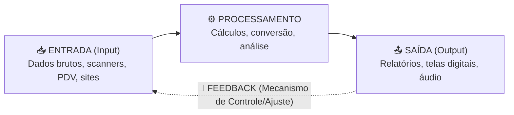

# 📘 UA01: Os Fatores Motivadores da Governança de TI

> [!abstract] **Objetivos de Aprendizagem (SAGAH)**
> - Reconhecer a importância da tecnologia no contexto corporativo.
> - Definir os principais aspectos de uso e fatores motivadores da governança de TI.
> - Descrever os aspectos da área corporativa e o uso de recursos tecnológicos (processos, funções e componentes de SI).

---

## 📌 1. Introdução e Contextualização

Nas organizações contemporâneas, a Tecnologia da Informação deixou de ser uma área puramente operacional de suporte técnico para se tornar a espinha dorsal dos negócios. Conforme destaca Baltzan (2016), o impacto da TI na sociedade e no ambiente empresarial é equivalente ao impacto da imprensa na difusão do conhecimento ou da energia elétrica na produtividade industrial.

Historicamente, o ponto de inflexão para o reconhecimento da criticidade da TI ocorreu com episódios como o **Bug do Milênio (ano 2000)**, que evidenciou a vulnerabilidade e a dependência direta das empresas em relação aos seus sistemas computacionais. A partir daí, tornou-se imperativo gerenciar a tecnologia não apenas como ferramenta técnica, mas sob o prisma da governança, mitigando riscos e alinhando investimentos aos objetivos estratégicos da organização.

> **Princípio-Chave:** Governança de TI é o conjunto de diretrizes, processos e estruturas de tomada de decisão que garante que os investimentos em tecnologia gerem valor real ao negócio e mitiguem riscos operacionais, promovendo a transparência administrativa.

---

## 🧬 2. Núcleo Conceitual (O "Como" e o "Porquê")

### 🔄 Processos e Sistemas de Informação (SI)
Uma corporação funciona como uma engrenagem contínua. Para que ela opere de forma harmônica, dois conceitos fundamentais precisam estar integrados:

1. **Processo (Slack et al., 2013):** Organização de recursos humanos, financeiros e materiais que transforma insumos (*inputs*) em produtos ou serviços (*outputs*) para atender necessidades de clientes.
2. **Sistema de Informação (Turban & Volonino, 2013):** Conjunto integrado que coleta, processa, armazena, analisa e dissemina informações para fins específicos dentro do negócio.



### 🧩 Os 6 Componentes Fundamentais de um SI
Conforme a modelagem de Turban e Volonino (2013), nenhum sistema de informação se resume a computadores. Ele é composto por seis pilares interdependentes:

- **🖥️ Hardware:** Dispositivos físicos (processadores, servidores, memória, telas e periféricos de entrada/saída).
- **💾 Software:** Conjunto de programas, aplicativos e instruções que determinam como o hardware deve processar dados.
- **📊 Dados e Informações:** A matéria-prima processada e organizada em bancos de dados.
- **🌐 Redes:** Infraestrutura de telecomunicações (cabeadas ou wireless) que conecta os elementos.
- **📋 Procedimentos:** Instruções, políticas e regras operacionais sobre como combinar componentes e executar rotinas de trabalho.
- **👥 Pessoas:** Usuários finais, analistas, operadores e clientes que interagem com o sistema e utilizam suas informações.

### 🚗 Analogia Feynman: O Carro como Sistema Integrado
> Pense em uma corporação moderna como um **carro de alta performance**:
> - O **Hardware** é o chassi e o motor;
> - O **Software** é o sistema de injeção eletrônica e a central multimídia;
> - O **Combustível (Dados)** precisa entrar limpo;
> - As **Redes** são o cabeamento elétrico que transmite sinais pelos sensores;
> - O **Manual do Proprietário (Procedimentos)** dita como dirigir sem fundir o motor;
> - O **Motorista (Pessoas)** decide a direção e a velocidade.
>
> Se você retirar um componente isolado (como o volante ou a bomba de combustível), o veículo inteiro para. A **Governança de TI** é a manutenção preventiva periódica e a telemetria que garantem que o carro chegue ao destino com segurança, no menor tempo e gastando o mínimo de combustível.

### ⚠️ Distinção Crítica: Governança Corporativa vs. Governança de TI
> [!warning] **Fique Atento (Pegadinha Clássica de Avaliação):**
> - **Governança Corporativa (IBGC, 2017):** É o sistema macro pelo qual as empresas são dirigidas, monitoradas e incentivadas. Envolve a relação entre sócios, conselho de administração, diretoria e órgãos de controle.
> - **Governança de TI:** Não substitui nem concorre com a governança corporativa; ela é uma **subdisciplina alinhada**, responsável por garantir que as estratégias tecnológicas convirjam com as diretrizes e metas estipuladas pela governança corporativa.

---

## 📊 3. Modelos Estruturais e Síntese Comparativa

### 🎯 Matriz de Impacto Estratégico da TI (Lynda Applegate)
A depender do modelo de negócios da empresa, a dependência em relação à TI varia drasticamente. A matriz de Applegate classifica a organização em quatro quadrantes baseados no impacto presente (operações) e futuro (estratégia):

```
       IMPACTO DA TI NAS OPERAÇÕES CHAVES (Presente)
              Alto ▲
                   │  🏭 FÁBRICA           │  🚀 ESTRATÉGICO
                   │  (Alta dependência    │  (TI transforma a
                   │   operacional atual;  │   indústria e define
                   │   baixo impacto no    │   o sucesso presente
                   │   futuro estratégico) │   e futuro do negócio)
                   ├───────────────────────┼────────────────────────
                   │  🛠️ SUPORTE           │  🔄 MUDANÇA
                   │  (Melhoria local;     │  (Baixo impacto no
                   │   baixo risco e baixo │   dia a dia presente;
                   │   impacto estratégico)│   alto impacto no
                   │                       │   direcionamento futuro)
              Baixo▼───────────────────────┴────────────────────────▶
                   Baixo                                    Alto
              IMPACTO DA TI NA ESTRATÉGIA CHAVE (Futuro)
```

| Quadrante | Impacto nas Operações (Dia a dia) | Impacto na Estratégia (Futuro) | Descrição e Comportamento Corporativo | Exemplo Típico |
| :--- | :--- | :--- | :--- | :--- |
| **🛠️ Suporte** | Baixo | Baixo | A TI atua apenas em tarefas administrativas locais; uma falha causa incômodo, mas não paralisa a empresa. | Escritório tradicional de advocacia |
| **🏭 Fábrica** | **Alto** | Baixo | As operações diárias dependem criticamente da TI, mas o negócio em si não é transformado por inovações de software. | Linha de produção fabril automatizada |
| **🔄 Mudança** | Baixo | **Alto** | O dia a dia ainda é analógico/tradicional, mas projetos futuros de TI definirão a sobrevivência da organização. | Varejo físico desenvolvendo plataforma de e-commerce |
| **🚀 Estratégico** | **Alto** | **Alto** | Tanto as operações correntes quanto a diferenciação futura dependem 100% da tecnologia para existir. | Bancos digitais (*fintechs*), Nubank, Uber |

---

## 🚀 4. Aplicações Práticas & Impactos da Infraestrutura

O uso e a gestão da infraestrutura tecnológica geram impactos diretos nos resultados organizacionais, conforme sintetizado no infográfico prático da Unidade:


### Benefícios Potenciais vs. Riscos da Ausência de Governança

* **📈 Expansão da Produtividade:** A gestão orientada a dados permite automação de tarefas manuais, redução de desperdícios e definição precisa de metas de crescimento.
* **🔒 Comprometimento da Segurança (Risco):** A segurança transcende senhas de acesso; ela resguarda o sigilo e a integridade de dados estratégicos contra espionagem e vazamentos em mercados altamente competitivos.
* **⛔ Indisponibilidade de Serviços (Risco):** Falhas em sistemas críticos geram paralisação imediata de transações financeiras, causando prejuízos econômicos diretos e danos reputacionais.
* **📉 Decadência no Desempenho (Risco):** Sistemas subdimensionados que se tornam lentos e obsoletos criam gargalos nas operações e frustram clientes internos e externos.

---

## 🎯 5. Dica do Professor (Foco em Provas)

> [!tip] **O que mais costuma cair em avaliações:**
> 1. **Funções Primordiais do SI:** Lembre-se da sequência exata: **Entrada ➔ Processamento ➔ Saída ➔ Feedback**. A ausência do mecanismo de *Feedback* invalida alternativas em provas.
> 2. **Definição de Processo e Procedimento:** *Processo* é a transformação de recursos em produtos; *Procedimentos* são as regras e instruções que orientam a execução dessas atividades.
> 3. **Fatores Motivadores:** Fique atento à lista de Fernandes e Abreu (2012): marcos regulatórios, segurança da informação, dependência tecnológica e ambiente de negócios.
> 4. **Matriz de Applegate:** Saber diferenciar com clareza o quadrante **Fábrica** (alto impacto no presente, baixo no futuro) do quadrante **Mudança** (baixo impacto no presente, alto no futuro).

---

## 🧠 6. Questões de Fixação (Active Recall & Sagah)

> **P1: A tecnologia pode ser vista como método ou técnica relacionada a uma atividade específica, e está inserida no contexto humano desde a descoberta do fogo. Podemos dizer que em meados da década de 40, ao ser inserida no contexto corporativo, o sistema de informação trouxe diversas vantagens, como:**  
> **Resposta Correta:** **b) Eficácia na produção, metodologias gerenciais e gerenciamento de dados.**  
> 🎯 **Por quê?** Nas décadas de 1940 e 1950 não existiam internet pública nem microcomputadores baratos/simples. A introdução inicial dos sistemas computacionais nas grandes corporações focava no processamento de lotes de dados em massa, otimização da eficácia produtiva e suporte a metodologias gerenciais centralizadas.

---

> **P2: Sobre a definição de processo, assinale a alternativa correta:**  
> **Resposta Correta:** **d) É a definição de procedimentos que norteiam a produção ou execução de algo específico.**  
> 🎯 **Por quê?** De acordo com a teoria da administração da produção (Slack et al., 2013), um processo representa uma organização coordenada de recursos e métodos sequenciais projetados para transformar insumos em resultados tangíveis que atendam a requisitos específicos de negócio.

---

> **P3: Assinale a alternativa que traz conceitos relacionados às principais funções de um sistema de informação:**  
> **Resposta Correta:** **e) Entrada, processamento, saída de dados e feedback.**  
> 🎯 **Por quê?** Conforme Turban e Volonino (2013), as quatro funções universais de qualquer Sistema de Informação são: entrada (*input* de dados), processamento (transformação/cálculo), saída (*output* de informações) e feedback (retroalimentação para controle e ajuste contínuo).

---

> **P4: Qual componente tecnológico está associado à realização da análise de rotinas que foram desenvolvidas para a realização de atividades específicas?**  
> **Resposta Correta:** **e) Procedimento.**  
> 🎯 **Por quê?** Procedimentos são formalmente definidos como o conjunto de instruções, manuais, políticas e rotinas que ensinam as pessoas como operar e integrar o hardware e o software para que o sistema execute a atividade desejada de forma padronizada.

---

> **P5: Assinale a alternativa que traz um dos serviços que pode ser desempenhado automaticamente por um sistema de informação em um contexto corporativo:**  
> **Resposta Correta:** **e) Processamento de informações e geração de relatórios com alta precisão e em alta velocidade.**  
> 🎯 **Por quê?** Serviços como seleção/contratação de pessoal, alocação de ativos e definições estratégicas exigem julgamento humano de gestão. A grande vantagem primária e automatizada do software corporativo reside no cálculo veloz e na emissão acurada de relatórios consolidados a partir de volumosas bases de dados.

---

## 📚 7. Referências e Conexões

- **BALTZAN, P.** *Tecnologia orientada para a gestão*. 6. ed. Porto Alegre: AMGH, 2016.
- **FERNANDES, A. A.; ABREU, V. F.** *Implantando a governança de TI: da estratégia à gestão de processos e serviços*. 3. ed. Rio de Janeiro: Brasport, 2012.
- **IBGC.** *Instituto Brasileiro de Governança Corporativa: Governança Corporativa*. São Paulo: IBGC, 2017.
- **SLACK, N. et al.** *Gerenciamento de operações e de processos: princípios e práticas de impacto estratégico*. 2. ed. Porto Alegre: Bookman, 2013.
- **TURBAN, E.; VOLONINO, L.** *Tecnologia da informação para gestão: em busca de um melhor desempenho estratégico e operacional*. 8. ed. Porto Alegre: Bookman, 2013.
- [[GUIA_PADRONIZACAO]]
