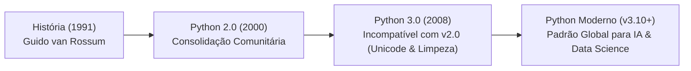

# 📘 UA01: Introdução ao Python e Ambiente de Desenvolvimento

> [!abstract] **Objetivos de Aprendizagem (SAGAH)**
> - Descrever a evolução histórica da linguagem Python e sua filosofia de design.
> - Compreender a instalação do interpretador Python e dos ambientes de desenvolvimento integrados (IDEs).
> - Diferenciar os principais ambientes e ferramentas de implementação (IDLE, PyCharm, VS Code, Jupyter/Anaconda).

---

## 📌 1. Introdução e Contextualização

A linguagem de programação Python consolidou-se como o ecossistema líder absoluto em Inteligência Artificial, Ciência de Dados e Aprendizado de Máquina. Criada no início dos anos 1990 pelo matemático e desenvolvedor holandês **Guido van Rossum**, o Python nasceu com o propósito de tornar a programação intuitiva, legível e altamente produtiva, reduzindo o atrito sintático característico de linguagens como C++ ou Java.

O nome da linguagem é uma homenagem bem-humorada ao grupo circense britânico de comédia *Monty Python's Flying Circus*, do qual Guido era fã. Contudo, na publicação do primeiro livro impresso de programação em Python, a editora sugeriu estampar uma serpente da espécie píton na capa, consolidando mundialmente o réptil como o logotipo da tecnologia.

> **Princípio-Chave:** Python prioriza a legibilidade do código e a produtividade do desenvolvedor (*"Readability counts"*), combinando tipagem dinâmica e forte em um ambiente interpretado de alto nível.

---

## 🧬 2. Núcleo Conceitual (O "Como" e o "Porquê")

### ⚙️ Características Técnicas Fundamentais
* **Linguagem Interpretada:** O código-fonte é compilado em tempo de execução para um código intermediário (*bytecode*), executado pela Máquina Virtual Python (PVM).
* **Tipagem Dinâmica e Forte:**
  * *Dinâmica:* Não é necessário declarar o tipo da variável antes de utilizá-la (`x = 10` infere inteiro automaticamente).
  * *Forte:* O interpretador impede operações inválidas entre tipos incompatíveis sem conversão explícita (somar `"10" + 5` gera erro de tipo `TypeError`).
* **Multiplataforma:** O mesmo script executa de forma idêntica em Windows, Linux e macOS.
* **A Transição Histórica Python 2 vs. Python 3:**
  * O **Python 3.0 (lançado em 2008)** introduziu uma quebra histórica intencional: **incompatibilidade retroativa deliberada com o Python 2.x**, corrigindo falhas fundamentais de manipulação de strings (Unicode por padrão) e divisão inteira.



### 💻 Ecossistema de Ambientes de Desenvolvimento (IDEs)

- **IDLE (Integrated Development and Learning Environment):** O ambiente padrão oficial que já vem embarcado na instalação do Python. Fornece um console interativo (*Python Shell*) e um editor de scripts leve.
- **PyCharm (JetBrains):** Uma das IDEs profissionais mais robustas do mercado. Multiplataforma, com suporte avançado a autocompletar inteligente, depuração, controle de versão e frameworks web como Django. Exige privilégios de administrador e o Python pré-instalado.
- **VS Code (Microsoft):** Editor de código modular altamente customizável através de extensões oficiais para Python e Jupyter.
- **Jupyter Notebook / Google Colab:** Ambiente baseado na web focado em blocos interativos (*células*), ideal para experimentação e modelos de Machine Learning.

### 🐍 Analogia Feynman: O Python como Canivete Suíço de Montar
> Programar em linguagens de baixo nível como C é como forjar sua própria chave de metal a cada porta que você precisa abrir: você controla cada dente da chave, mas gasta horas no processo.
> 
> Programar em **Python** é como ter um **canivete suíço inteligente**: você foca diretamente na porta que quer abrir. Se precisar de cálculo numérico, puxa a lâmina do `numpy`; se precisar de redes neurais, puxa o acessório do `pytorch`. A sintaxe limpa permite ao cientista pensar na inteligência do modelo em vez de gastar tempo gerenciando memória e ponteiros.

---

## 📊 3. Síntese Comparativa das Ferramentas de Desenvolvimento

| Ferramenta | Distribuição / Origem | Nível de Complexidade | Foco Recomendado | Requisitos de Instalação |
| :--- | :--- | :--- | :--- | :--- |
| **IDLE** | Embutido no instalador do Python | Muito Baixo (Básico) | Ensino inicial e testes rápidos de comandos | Nenhum (instalado com o Python) |
| **PyCharm Community** | JetBrains (Gratuito/Open-Source) | Alto (Profissional) | Grandes projetos de software e engenharia | Administrador + Python instalado |
| **VS Code** | Microsoft (Gratuito) | Médio | Desenvolvimento geral e scripts | Extensão Python do VS Code |
| **Jupyter Notebook** | Projeto Jupyter / Anaconda | Médio (Interativo) | Análise de dados, visualização gráfica e IA | Instalação via `pip` ou Anaconda |

---

## 🚀 4. Aplicação Prática: Execução Básica no Shell Interativo

No prompt interativo do IDLE (reconhecido pelo prefixo `>>>`), operações matemáticas e saídas de texto são avaliadas diretamente sem necessidade de compilação:

```python
# Modo Interativo do Python (IDLE Shell)
>>> 1024 / 2
512.0

>>> print("eu estudo Python")
eu estudo Python

>>> -2 + 15
13
```

---

## 🎯 5. Dica do Professor (Foco em Provas)

> [!tip] **O que mais costuma cair em avaliações:**
> 1. **Incompatibilidade do Python 3:** Lembre-se de que o Python 3.0 **não é compatível** com o Python 2.x. Softwares antigos escritos em Python 2 precisavam ser adaptados ou migrados com utilitários como `2to3`.
> 2. **Origem do Símbolo da Serpente:** A escolha do nome homenageou a série de comédia britânica *Monty Python*, mas o símbolo da cobra surgiu porque a editora que publicou o primeiro livro colocou uma píton na capa.
> 3. **Ambiente Embarcado:** A única IDE que vem pré-instalada de forma nativa e automática com o instalador do Python é o **IDLE**. Ambientes como PyCharm, Eclipse ou VS Code exigem download e instalação em separado.
> 4. **Cálculos Diretos no Console:** No IDLE interativo, para calcular uma operação simples, basta digitar a expressão matemática diretamente no prompt `>>> - 2 + 15` sem comandos adicionais como `math` ou `calculate`.

---

## 🧠 6. Questões de Fixação (Active Recall & SAGAH)

> **P1: Atualmente, o Python segue em releases da versão 3.0. Qual é a peculiaridade dessa versão?**  
> **Resposta Correta:** **c) Ser incompatível com a versão 2.0.**  
> 🎯 **Por quê?** O Python 3.0 foi concebido intencionalmente com quebra de retrocompatibilidade para sanar falhas históricas de arquitetura, unificar o tratamento de cadeias de caracteres em Unicode e redesenhar funções internas.

---

> **P2: A linguagem de programação Python foi criada pelo matemático Guido van Rossum, que escolheu esse nome em homenagem ao grupo Monty Python. Sendo assim, por que a capa do primeiro livro estampou uma cobra da espécie píton?**  
> **Resposta Correta:** **a) Porque a editora que iria lançar o livro sugeriu a figura na capa.**  
> 🎯 **Por quê?** A associação da linguagem à serpente decorreu de uma sugestão comercial e editorial da editora O'Reilly na ilustração da primeira publicação formal sobre a linguagem.

---

> **P3: Qual é o comando correto para apresentar o resultado da soma entre os números -2 e 15 na IDE IDLE?**  
> **Resposta Correta:** **e) >>> - 2 + 15.**  
> 🎯 **Por quê?** O prompt interativo do IDLE funciona nativamente como uma calculadora científica, avaliando e imprimindo automaticamente o resultado de qualquer expressão aritmética válida.

---

> **P4: Dentre os ambientes integrados de desenvolvimento (IDEs), qual deles vem embutido no pacote do Python e é instalado automaticamente com a linguagem?**  
> **Resposta Correta:** **b) Idle.**  
> 🎯 **Por quê?** O IDLE é o ambiente padrão fornecido pela Python Software Foundation (PSF), distribuído juntamente com o executável básico da linguagem.

---

> **P5: A PyCharm é uma IDE gratuita desenvolvida pela JetBrains. Sabendo que ela não vem embarcada no pacote de instalação do Python, quais são os requisitos para sua instalação?**  
> **Resposta Correta:** **d) Permissão de administrador e Python pré-instalados.**  
> 🎯 **Por quê?** A instalação do PyCharm requer privilégios de sistema para gravar arquivos executáveis e depende do interpretador Python previamente instalado no sistema operacional para configurar o interpretador do projeto.

---

## 📚 7. Referências e Conexões

- **BARRY, P.** *Use a cabeça! Programação*. 2. ed. Rio de Janeiro: Alta Books, 2018.
- **LUTZ, M.** *Aprendendo Python*. 4. ed. Porto Alegre: Bookman, 2011.
- Plataforma SAGAH: Unidade de Aprendizagem *Python e ambientes de desenvolvimento*.
- [[UA02 - Funções e Programação Orientada a Objetos em Python]]
- [[UA03 - Conceitos Básicos de Aprendizado de Máquina]]
