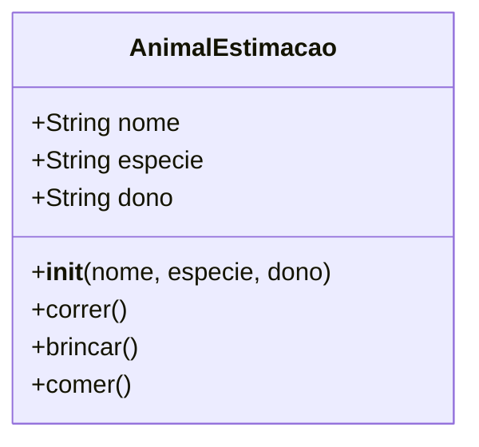

# 📘 UA02: Funções e Programação Orientada a Objetos em Python

> [!abstract] **Objetivos de Aprendizagem (SAGAH)**
> - Reconhecer e implementar funções modulares em Python (`def`, parâmetros, valor de retorno e escopos).
> - Compreender a distinção entre variáveis de escopo local e escopo global (`global`).
> - Definir classes e instanciar objetos concretos aplicando os princípios da Programação Orientada a Objetos (POO), métodos construtores (`__init__`) e a convenção de encapsulamento.

---

## 📌 1. Introdução e Contextualização

Em projetos de Inteligência Artificial e sistemas complexos, escrever código sequencial contínuo (*código espaguete*) torna a manutenção inviável e gera duplicações de código suscetíveis a falhas. Para estruturar aplicações robustas e reutilizáveis, duas abstrações são essenciais:

1. **Funções:** Sub-rotinas independentes que agrupam blocos de instruções voltados a resolver uma tarefa específica, recebendo dados de entrada (*parâmetros*) e devolvendo um resultado (*retorno*).
2. **Classes e Objetos (POO):** Modelagem computacional que encapsula dados (*atributos*) e comportamentos (*métodos*) inspirados em entidades do mundo real (como modelos de regressão, redes neurais ou registros de pacientes).

> **Princípio-Chave:** Enquanto funções organizam o fluxo lógico e evitam a repetição de instruções (*DRY - Don't Repeat Yourself*), a orientação a objetos organiza o estado e as responsabilidades dos dados através de moldes estruturados (classes).

---

## 🧬 2. Núcleo Conceitual (O "Como" e o "Porquê")

### 🛠️ Funções em Python: Anatomia e Escopo
As funções são declaradas através da palavra-chave `def`. 
- Caso uma função não possua uma instrução `return` explícita, o Python retorna automaticamente o valor especial `None` (tipo `NoneType`).
- **Escopo Local vs. Escopo Global:**
  - Variáveis criadas dentro de uma função existem apenas durante a sua execução no **escopo local** e são descartadas da memória após o retorno.
  - Para permitir que uma função altere diretamente o valor de uma variável declarada fora dela, é necessário utilizar a declaração explícita `global nome_variavel`.

```python
total_amostras = 0  # Escopo Global

def registrar_lote(qtd):
    global total_amostras
    contagem_local = qtd * 2  # Escopo Local
    total_amostras += contagem_local
    return contagem_local
```

---

### 🏛️ Paradigma de Orientação a Objetos (POO)

* **Classe:** O modelo conceitual, molde ou planta baixa (ex.: a classe `Animal` ou `RedeNeural`).
* **Objeto / Instância:** A manifestação concreta criada a partir da classe, alocada na memória com valores individuais próprios (ex.: `rex = Animal("Rex", "Cão")`).
* **O Método Construtor `__init__`:** Inicializador chamado automaticamente no instante da criação do objeto para receber parâmetros e atribuir os estados iniciais.
* **O Parâmetro `self`:** Referência explícita ao próprio objeto em execução. Permite que um método diferencie os atributos daquela instância específica das variáveis locais do método.



### 🔒 Encapsulamento em Python e a Convenção de Underlines
Diferente de C++ ou Java, o Python **não possui palavras-chave nativas como `private` ou `protected`**. A filosofia da linguagem adota o princípio de que *"somos todos adultos conscientes"*:
- **Atributo Público (`self.saldo`):** Acesso livre de leitura e escrita externa.
- **Convenção de Uso Interno (`self._saldo`):** Um único sublinhado indica aos outros desenvolvedores que o atributo não deve ser acessado diretamente fora da classe.
- **Name Mangling (`self.__saldo`):** Dois sublinhados fazem o interpretador renomear internamente a variável (para `_NomeDaClasse__saldo`), dificultando o acesso acidental e prevenindo conflitos em subclasses de herança.

---

### 🐶 Analogia Feynman: O Molde de Biscoitos
> Pense em uma **Classe** como um **cortador de biscoitos em formato de estrela**:
> - O cortador é a classe `Biscoito`. Ele define a forma, os limites e os dentes do biscoito, mas você não pode comê-lo.
> - A massa assada que sai do forno é o **Objeto**. Cada biscoito é uma instância real: um pode ter confeito de chocolate, outro confeito de morango (seus *atributos* individuais).
> - Se você quebrar um biscoito na mesa, os outros biscoitos da forma continuam intactos, porque cada objeto tem seu próprio estado independente.

---

## 📊 3. Síntese Comparativa: Funções vs. Classes

| Aspecto de Design | Funções (`def`) | Classes (`class`) |
| :--- | :--- | :--- |
| **Abstração Central** | Processamento e verbos de ação (fazer, calcular, validar). | Entidades e substantivos (usuário, classificador, conjunto de dados). |
| **Persistência de Estado** | Não preserva estado interno entre chamadas consecutivas (sem truques). | Preserva estado contínuo e histórico através de atributos (`self`). |
| **Composição** | Composta por instruções, parâmetros e retorno. | Composta por atributos (dados) e métodos (funções internas). |
| **Uso em Machine Learning** | Pré-processamento simples, funções de ativação e métricas de erro. | Modelos completos de IA (ex.: `LinearRegression()`, `DecisionTreeClassifier()`). |

---

## 🚀 4. Aplicação Prática: Modelagem de Objeto Geométrico

Criação de uma classe em Python para simulação de peças industriais (conforme o Desafio do Pneu):

```python
import math

class CirculoPneu:
    def __init__(self, pos_x: float, pos_y: float, raio: float):
        self.x = pos_x
        self.y = pos_y
        self.raio = raio

    def calcular_diametro(self) -> float:
        return 2 * self.raio

    def calcular_area(self) -> float:
        return math.pi * (self.raio ** 2)

    def calcular_perimetro(self) -> float:
        return 2 * math.pi * self.raio

    def deslocar_posicao(self, novo_x: float, novo_y: float) -> None:
        self.x = novo_x
        self.y = novo_y

# Teste de instanciação e execução
pneu_dianteiro = CirculoPneu(pos_x=0.0, pos_y=0.0, raio=35.0)
print(f"Área: {pneu_dianteiro.calcular_area():.2f} cm²")
print(f"Diâmetro: {pneu_dianteiro.calcular_diametro():.2f} cm")
```

---

## 🎯 5. Dica do Professor (Foco em Provas)

> [!tip] **O que mais costuma cair em avaliações:**
> 1. **Objetivo Principal de Funções:** Funções servem prioritariamente para **reutilização de código e facilidade de manutenção**, e não apenas para limitar o número de linhas por arquivo.
> 2. **A Palavra-Chave `global`:** É utilizada para permitir que uma função **modifique** o valor de uma variável que foi declarada fora do seu escopo local. Se você apenas ler uma variável global, o uso de `global` não é obrigatório.
> 3. **Relação de Classes e Objetos:** Cria-se **uma classe** para modelar o conceito abstrato geral (ex.: classe `Animal`) e **um objeto para cada instância individual** concreta registrada no sistema.
> 4. **Encapsulamento com `__`:** Em Python, o uso de dois underscores antes do atributo ativa o *Name Mangling* para sugerir privacidade, pois a linguagem **não possui a palavra-chave `private`**.

---

## 🧠 6. Questões de Fixação (Active Recall & SAGAH)

> **P1: Funções em programação podem ser comparadas às cenas de um filme. Na programação, funções são blocos que executam tarefas específicas. Assinale a afirmação correta:**  
> **Resposta Correta:** **c) Funções têm como principais objetivos reutilizar o código e facilitar a manutenção do sistema.**  
> 🎯 **Por quê?** Ao encapsular uma lógica em uma função, você evita duplicar código e centraliza futuras correções em um único ponto do programa, garantindo alta manutenibilidade.

---

> **P2: Em um código onde a variável `contador_total` é definida fora da função e referenciada como `global contador_total` dentro dela, assinale a alternativa que justifica corretamente esse uso:**  
> **Resposta Correta:** **a) A definição global foi utilizada para permitir que a função modifique uma variável que existe fora do escopo local, atualizando seu valor ao longo da execução do programa.**  
> 🎯 **Por quê?** Em Python, variáveis declaradas no escopo global são acessíveis para leitura em qualquer função. Contudo, para atribuir ou incrementar um novo valor (`+= 1`), o interpretador exige a declaração explícita `global` para não criar acidentalmente uma variável local de mesmo nome.

---

> **P3: Sobre classes e objetos para cadastro de animais em um sistema, assinale a sequência correta de V e F para:**  
> I. Uma classe para cada animal. (F)  
> II. Um objeto para cada tipo de animal. (F)  
> III. Uma classe e um objeto para cada animal. (F)  
> IV. Uma classe para representar animal e um objeto para representar cada animal a ser cadastrado. (V)  
> V. Um objeto e diversas classes para representar os animais. (F)  
> **Resposta Correta:** **d) F – F – F – V – F.**  
> 🎯 **Por quê?** Em POO, o modelo abstrato é único (uma classe `Animal`), enquanto as entidades individuais concretas são objetos múltiplos instanciados a partir dessa classe.

---

> **P4: Em POO, considere as afirmações:**  
> I. O encapsulamento de atributos pode ser indicado pelo uso de dois underscores (`__`) antes do nome da variável.  
> PORQUE  
> II. Em Python, diferentemente de outras linguagens, não existe o modificador de acesso `private`, sendo o controle baseado em convenções e name mangling.  
> **Resposta Correta:** **a) As afirmações I e II são verdadeiras, e a II justifica a I.**  
> 🎯 **Por quê?** Como a linguagem Python não possui a palavra reservada `private` em sua gramática formal, ela recorre à convenção léxica de dois underscores para ofuscar o identificador no escopo da classe.

---

> **P5: Considere a classe `Refeicao` instanciada por `r = Refeicao(5, 6, 7, 8)` com o método `calcula_media()`. Assinale a alternativa correta:**  
> **Resposta Correta:** **e) O objeto r criado a partir da classe Refeicao é uma instância que permite acessar atributos e executar o método de cálculo da média nutricional.**  
> 🎯 **Por quê?** `r` é um objeto concreto gerado em memória, possuindo os atributos individuais inicializados pelo construtor e acesso aos métodos públicos definidos no molde da classe.

---

## 📚 7. Referências e Conexões

- **DOWNEY, A.** *Pense em Python: pense como um cientista da computação*. 2. ed. São Paulo: Novatec, 2021.
- **LUTZ, M.; ASCHER, D.** *Aprendendo Python*. Porto Alegre: Bookman, 2007.
- Plataforma SAGAH: Unidade de Aprendizagem *Introdução ao Python II*.
- [[UA01 - Introdução ao Python e Ambiente de Desenvolvimento]]
- [[UA03 - Conceitos Básicos de Aprendizado de Máquina]]
