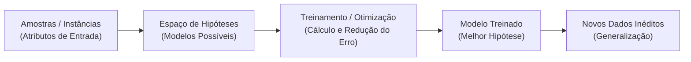

# 📘 UA03: Conceitos Básicos de Aprendizado de Máquina

> [!abstract] **Objetivos de Aprendizagem (SAGAH)**
> - Definir a área de Aprendizado de Máquina (*Machine Learning - ML*) e sua terminologia essencial.
> - Demonstrar o ciclo completo do processo de aprendizado: dados, hipóteses, treinamento e generalização.
> - Identificar e diferenciar as principais tarefas de aprendizado supervisionado (Classificação e Regressão) e não supervisionado (Agrupamento).

---

## 📌 1. Introdução e Contextualização

Tradicionalmente, a computação operava pelo paradigma da programação imperativa clássica: um engenheiro humano deduzia as regras lógicas de negócio e as codificava manualmente para transformar entradas em saídas. Contudo, para problemas complexos do mundo real — como direção autônoma de veículos, reconhecimento de voz ou diagnóstico médico por imagens —, as regras são sutis, dinâmicas e impossíveis de serem exaustivamente descritas em código estático.

O **Aprendizado de Máquina (Machine Learning)** inverte essa lógica: em vez de programar regras explícitas, fornecemos à máquina grandes volumes de dados de exemplo (entradas e saídas esperadas) e algoritmos matemáticos que aprendem a extrair padrões estatísticos e construir a função que mapeia novas entradas.

> **Princípio-Chave:** O objetivo central do Machine Learning não é apenas memorizar os exemplos de treino, mas **generalizar**: inferir com precisão a resposta para dados inéditos que o modelo nunca viu antes.

---

## 🧬 2. Núcleo Conceitual (O "Como" e o "Porquê")

### 🔄 O Fluxo de Aprendizado de Máquina
O processo de ML opera através de um pipeline iterativo de otimização:



### 📚 Terminologia Fundamental
- **Instância / Amostra:** Uma linha individual do conjunto de dados (ex.: um paciente específico).
- **Atributos de Entrada (*Features* / $X$):** Características mensuráveis da amostra (ex.: idade, peso, pressão arterial).
- **Atributo Alvo (*Target* / $y$):** A resposta que desejamos prever (ex.: diagnóstico positivo ou negativo).
- **Espaço de Hipóteses:** O conjunto de todas as funções matemáticas possíveis que o algoritmo pode escolher para aproximar o problema.

---

### 🎯 As Grandes Famílias de Tarefas em ML

#### 1. Aprendizado Supervisionado
O conjunto de dados possui o atributo alvo ($y$) rotulado previamente por especialistas. Divide-se em:
- **Classificação:** O alvo é um valor **discreto / categórico**. O algoritmo encontra uma *fronteira de decisão* separando classes (ex.: email Spam vs. Não Spam; transação legítima vs. fraude; diagnóstico Saudável vs. Doente).
- **Regressão:** O alvo é um valor **contínuo / numérico**. O algoritmo ajusta uma curva estimando grandezas infinitas (ex.: previsão do preço de um imóvel em R$; estimativa de temperatura ou faturamento).

#### 2. Aprendizado Não Supervisionado
O conjunto de dados **não possui rótulos ou classes prévias**. O objetivo é descobrir estruturas latentes:
- **Agrupamento (*Clustering*):** Detectar agrupamentos naturais de instâncias similares (ex.: segmentação de clientes para marketing).

---

### ⚠️ O Equilíbrio da Generalização: Overfitting vs. Underfitting

```
            UNDERFITTING                     MODELO IDEAL                     OVERFITTING
      (Subajuste / Muito Raso)             (Boa Generalização)          (Sobreajuste / Decoreba)
      
          o     o   x     x                   o     o   x     x             o ┌──┐o   x ┌──┐x
             o        x                          o ────┼── x                    o │  │ x     │ x
          o   o     x   x                     o   o    │x   x             o ──┘  └──┘ ───┘
          
    Erro Alto no Treino e no Teste.     Erro Baixo no Treino e Teste.     Erro Zero no Treino;
    O modelo é simples demais.          Aprendeu o padrão real.          Erro Alto no Teste (ruído decorado).
```

- **Overfitting (Sobreajuste):** Ocorre quando o modelo é excessivamente complexo ou treinado por tempo excessivo, decorando os ruídos e peculiaridades dos dados de treino em vez do padrão geral. Falha categoricamente ao receber dados novos.
- **Underfitting (Subajuste):** O modelo é simples demais e não consegue capturar nem mesmo a tendência básica dos dados.

### 🚗 Analogia Feynman: O Aluno que Entende vs. O Aluno que Decora a Prova
> Pense em dois estudantes se preparando para o vestibular de Física:
> - O **Estudante Overfitted:** Ele decorou cada número, vírgula e gabarito exato dos 100 exercícios da apostila. Na prova da apostila, ele tira nota 10. Porém, no dia do vestibular real, o professor apenas mudou a massa do bloco de 5 kg para 7 kg. O aluno erra a questão inteira, porque ele decorou o ruído da apostila em vez de aprender as Leis de Newton.
> - O **Estudante Ideal (Generalizado):** Ele aprendeu a relação fundamental de $F = m \cdot a$. Ele pode errar pequenos detalhes de conta na apostila (erro pequeno de treino), mas diante de qualquer valor novo na prova real, ele resolve com sucesso.

---

## 📊 3. Síntese Comparativa das Tarefas Supervisionadas

| Característica | Tarefa de Classificação | Tarefa de Regressão |
| :--- | :--- | :--- |
| **Natureza do Alvo ($y$)** | Discreta / Categórica (Classes finitas) | Contínua / Numérica (Valores reais infinitos) |
| **Mecanismo Geométrico** | Fronteira de Decisão (Hiperplano separador) | Reta ou Curva de Ajuste (Tendência dos pontos) |
| **Métricas de Avaliação** | Acurácia, Precisão, Recall, F1-Score, ROC/AUC | Erro Quadrático Médio (MSE), RMSE, MAE, $R^2$ |
| **Exemplos do Cotidiano** | Filtro anti-spam, diagnóstico médico, triagem | Preço de ações, previsão de demanda, valor de imóveis |

---

## 🚀 4. Aplicação Prática: Identificação de Padrões Lógicos e Matemáticos

No aprendizado de máquina, o reconhecimento de padrões baseia-se em leis invariantes presentes nas amostras:

1. **Padrão Geométrica de Triângulos (Desafio Sagah):**
   A relação entre o índice $n$ do hexágono e o total de triângulos simples obedece à equação quadrática:
   $$T(n) = 6 \cdot n^2 \implies T(10) = 6 \cdot 10^2 = 600 \text{ triângulos}$$
2. **Matriz de Padrões Lógicos (Regra XOR):**
   Ao sobrepor blocos visuais, o algoritmo aprende a operação de *Ou Exclusivo*: se os quadrantes são de cores iguais, o resultado é branco; se são diferentes, o resultado é azul.

---

## 🎯 5. Dica do Professor (Foco em Provas)

> [!tip] **O que mais costuma cair em avaliações:**
> 1. **Definição de Overfitting:** Quando a questão menciona que o algoritmo *"especializou-se no treino e perdeu a capacidade de generalização para novas entradas"*, a resposta é inequivocamente **Overfitting**.
> 2. **Distinção Rápida entre Regressão e Classificação:**
>    - Prever valores monetários (R$), temperatura, altura ➔ **Regressão**.
>    - Prever categorias (Sim/Não, Aprovado/Reprovado, Fraude/Legítimo) ➔ **Classificação**.
> 3. **Fronteira de Decisão:** Linhas retas ou curvas em gráficos cartesianos que delimitam regiões separando bolinhas de cores diferentes representam a **linha de decisão de uma Classificação**.

---

## 🧠 6. Questões de Fixação (Active Recall & SAGAH)

> **P1: Em aprendizado de máquina, quando o excesso de amostras faz com que o algoritmo se especialize no conjunto de dados e seja incapaz de generalizar suas previsões para novas entradas, esse fenômeno é conhecido como:**  
> **Resposta Correta:** **a) Overfitting.**  
> 🎯 **Por quê?** O sobreajuste (*overfitting*) descreve a falha em que a máquina memoriza as variações espúrias e ruídos do treinamento, tornando-se incapaz de inferir corretamente sobre dados novos.

---

> **P2: Identifique o padrão de mudança entre os blocos visuais e determine a regra aplicada na matriz:**  
> **Resposta Correta:** **Regra XOR (Ou Exclusivo) — Cores iguais resultam em branco; cores diferentes resultam em azul.**  
> 🎯 **Por quê?** O reconhecimento de padrões em imagens frequentemente se baseia em mapeamento booleano pixel a pixel, onde o operador XOR sintetiza a fusão de camadas.

---

> **P3: Considerando um gráfico que apresenta duas nuvens de pontos rotulados (azul e laranja) separados por uma linha divisória, qual tipo de aprendizado está sendo aplicado?**  
> **Resposta Correta:** **a) Classificação (Supervisionada).**  
> 🎯 **Por quê?** A presença de rótulos definidos e de uma linha delimitando o espaço bidimensional configura formalmente a fronteira de decisão de um classificador supervisionado.

---

> **P4: Quais tarefas de Machine Learning devem ser utilizadas na previsão dos conceitos-alvo para as Tabelas 1 (Preço em R$), 2 (Spam Sim/Não) e 3 (Situação de Saúde Saudável/Doente)?**  
> **Resposta Correta:** **a) 1: Regressão. 2: Classificação. 3: Classificação.**  
> 🎯 **Por quê?** O preço é uma variável numérica contínua em escala infinita (regressão), enquanto o filtro de spam e o diagnóstico de saúde são classes discretas finitas e mutuamente exclusivas (classificação).

---

> **P5: Identifique o padrão da sequência numérica nas linhas: L1 (15, 22, 29, X); L2 (20, 28, 36, Y); L3 (25, 34, 43, Z). Quais são os valores de X, Y e Z?**  
> **Resposta Correta:** **a) X = 36; Y = 44; Z = 52.**  
> 🎯 **Por quê?** Trata-se de progressões aritméticas simples: na Linha 1 a razão é $+7$ ($29 + 7 = 36$); na Linha 2 a razão é $+8$ ($36 + 8 = 44$); na Linha 3 a razão é $+9$ ($43 + 9 = 52$).

---

## 📚 7. Referências e Conexões

- **FACELI, K. et al.** *Inteligência Artificial: uma abordagem de aprendizado de máquina*. 2. ed. Rio de Janeiro: LTC, 2021.
- **MITCHELL, T. M.** *Machine Learning*. New York: McGraw-Hill, 1997.
- Plataforma SAGAH: Unidade de Aprendizagem *Introdução à aprendizagem de máquina*.
- [[UA02 - Funções e Programação Orientada a Objetos em Python]]
- [[UA04 - Árvores de Decisão e Regressão com Scikit-Learn]]
