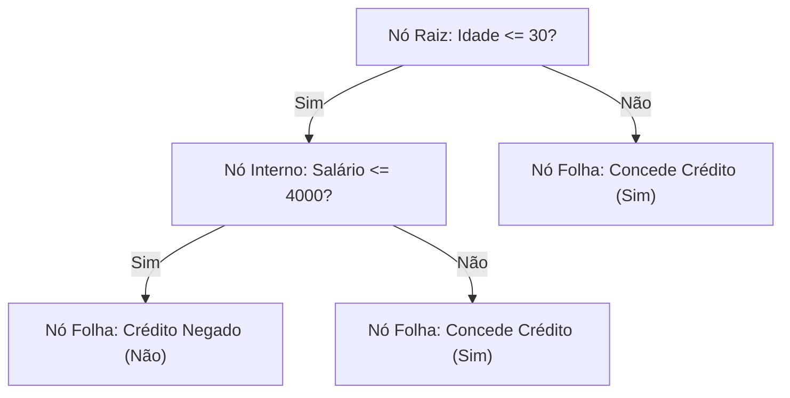

# 📘 UA04: Árvores de Decisão e Regressão com Scikit-Learn

> [!abstract] **Objetivos de Aprendizagem (SAGAH)**
> - Desenvolver conjuntos de dados estruturados para predição supervisionada (classificação e regressão).
> - Aplicar algoritmos clássicos de Árvores de Decisão (ID3, C4.5, CART) utilizando a biblioteca `scikit-learn`.
> - Determinar e interpretar métricas de avaliação utilizando métodos de amostragem (Hold-Out e Validação Cruzada / *Cross-Validation*).

---

## 📌 1. Introdução e Contextualização

As **Árvores de Decisão (*Decision Trees*)** representam um dos algoritmos de aprendizado supervisionado mais populares e intuitivos da Inteligência Artificial. Sua maior força reside na **interpretabilidade**: enquanto redes neurais profundas funcionam frequentemente como "caixas-pretas", uma árvore de decisão produz um grafo hierárquico transparente de regras condicionais (*"Se feature X <= limiar, vá para a esquerda; senão, vá para a direita"*), permitindo que humanos auditem exatamente o porquê de cada decisão tomada.

No ecossistema Python, a biblioteca **`scikit-learn`** fornece implementações otimizadas do algoritmo CART (*Classification and Regression Trees*), permitindo treinar tanto modelos de classificação (`DecisionTreeClassifier`) quanto modelos de regressão (`DecisionTreeRegressor`).

> **Princípio-Chave:** Uma árvore de decisão particiona recursivamente o espaço de atributos em regiões retangulares cada vez mais puras, buscando maximizar o ganho de informação em cada nó de divisão.

---

## 🧬 2. Núcleo Conceitual (O "Como" e o "Porquê")

### 🌳 Anatomia e Algoritmos Clássicos
A estrutura de uma árvore é composta por:
1. **Nó Raiz (*Root*):** O primeiro teste no topo da árvore, contendo a totalidade das amostras.
2. **Nós Internos de Divisão:** Testes condicionais sobre um atributo específico ($X_i \le \theta$).
3. **Nós Folhas (*Leaf Nodes*):** Os nós terminais que não se dividem mais e contêm a classe final prevista ou o valor numérico médio.

* **Família de Algoritmos:** ID3 (baseado em Entropia pura), C4.5 (suporta atributos contínuos e poda), C5.0 e **CART** (utilizado nativamente pelo Scikit-Learn, gerando árvores estritamente binárias).



### 📏 Critérios de Divisão: Gini vs. Entropia
Para decidir qual atributo divide melhor os dados em cada nó, o algoritmo calcula a **impureza**:
* **Índice de Gini (`criterion='gini'`):** Mede a probabilidade de um elemento aleatório ser classificado incorretamente. É computacionalmente mais rápido por dispensar cálculos logarítmicos:
  $$I_G(p) = 1 - \sum_{i=1}^J p_i^2$$
* **Entropia e Ganho de Informação (`criterion='entropy'`):** Vinda da Teoria da Informação de Shannon, quantifica a desordem ou incerteza contida nas classes:
  $$H(X) = - \sum_{i=1}^J p_i \log_2(p_i)$$

---

### 🧪 Métodos de Amostragem e Validação de Desempenho

1. **Hold-Out Tradicional (`train_test_split`):**
   - Divide o dataset em duas fatias estáticas (ex.: 70% treino e 30% teste).
   - *Limitação:* Risco de viés decorrente de divisões aleatórias infelizes, podendo gerar 100% de acurácia aparente no treino e colapso no teste.
2. **Validação Cruzada (*k-Fold Cross-Validation*):**
   - O dataset é fatiado em $k$ blocos (dobras). O modelo é treinado $k$ vezes: a cada iteração, $k-1$ blocos treinam e 1 bloco testa. A métrica final é a **média aritmética dos $k$ testes**, oferecendo confiabilidade estatística robusta.

### 🌿 Analogia Feynman: O fluxograma de um Médico de Pronto-Socorro
> Pense em uma árvore de decisão como o **protocolo de triagem hospitalar**:
> - O médico pergunta: *"O paciente tem febre alta?"* (Nó Raiz).
> - Se SIM: *"A pressão sistólica está abaixo de 90?"* (Nó Interno).
> - Se SIM: Classifica imediatamente como *"Emergência Vermelha"* (Nó Folha).
> 
> Uma árvore sem controle de profundidade (*sem poda*) é como um médico paranoico que faz 150 perguntas irrelevantes (cor do sapato, time de futebol) antes de medicar: ele entra em **Overfitting**, decorando o perfil daquele paciente específico em vez de tratar a doença.

---

## 📊 3. Síntese Comparativa: Hold-Out vs. Cross-Validation

| Critério de Validação | Método Hold-Out | Validação Cruzada ($k$-Fold) |
| :--- | :--- | :--- |
| **Custo Computacional** | Baixo (treina o modelo 1 única vez) | Elevado (treina o modelo $k$ vezes consecutivas) |
| **Sensibilidade à Amostra**| Alta (depende da semente aleatória `random_state`) | Baixa (todas as amostras participam do teste) |
| **Risco de Falso Otimismo**| Elevado em datasets pequenos | Muito Baixo (estimador não enviesado) |
| **Implementação Scikit-Learn**| `train_test_split(X, y, test_size=0.3)` | `cross_val_score(modelo, X, y, cv=5)` |

---

## 🚀 4. Aplicação Prática: Otimização de Profundidade com Scikit-Learn

Código para encontrar a profundidade mínima ideal evitando sobreajuste no dataset de câncer de mama:

```python
from sklearn.datasets import load_breast_cancer
from sklearn.tree import DecisionTreeClassifier
from sklearn.model_selection import cross_val_score

# 1. Carregamento do Dataset
data = load_breast_cancer()
X, y = data.data, data.target

# 2. Busca pela profundidade mínima que maximiza a acurácia
for depth in range(2, 6):
    modelo = DecisionTreeClassifier(max_depth=depth, criterion="entropy", random_state=1)
    scores = cross_val_score(modelo, X, y, cv=5, scoring='accuracy')
    print(f"Profundidade: {depth} | Acurácia Média CV: {scores.mean()*100:.2f}%")

# Resultado: Com max_depth=3 obtém-se o ápice de generalização (~93.3%)
```

---

## 🎯 5. Dica do Professor (Foco em Provas)

> [!tip] **O que mais costuma cair em avaliações:**
> 1. **Quando NÃO Usar Árvores de Decisão:** Árvores de decisão degradam fortemente de desempenho em cenários de **dimensão elevada (*high dimensionality*)**, com centenas de atributos esparsos (como classificação de textos por saco de palavras).
> 2. **Sintaxe de Avaliação no Scikit-Learn:** A função `accuracy_score` recebe estritamente a ordem `(y_verdadeiro, y_predito)`. Passar `(X, y)` gera erro grave.
> 3. **Superando o Hold-Out:** Se a questão cita que o modelo obteve 100% no Hold-Out mas caiu drasticamente em novos testes, a solução canônica para obter métricas confiáveis é **substituir o Hold-Out por Validação Cruzada (*Cross-Validation*)**.
> 4. **Parâmetros de Controle:** `max_depth` controla a profundidade máxima; `criterion="entropy"` utiliza Ganho de Informação, enquanto `criterion="gini"` utiliza o índice de impureza de Gini.

---

## 🧠 6. Questões de Fixação (Active Recall & SAGAH)

> **P1: Ao executar um algoritmo de árvore de decisão, foi obtida acurácia de 100% no Hold-Out, mas em novos testes o desempenho despencou, indicando sobreajuste. Como obter resultados mais confiáveis sobre o desempenho do modelo?**  
> **Resposta Correta:** **e) Substituir a técnica de amostragem hold-out pela validação cruzada.**  
> 🎯 **Por quê?** A validação cruzada elimina a dependência de uma partição aleatória favorável, avaliando o algoritmo em múltiplas fatias independentes para garantir medição estatística fidedigna.

---

> **P2: Todo algoritmo de aprendizado de máquina tem vantagens e desvantagens. Em que situação as árvores de decisão NÃO são recomendadas?**  
> **Resposta Correta:** **a) Dimensão elevada.**  
> 🎯 **Por quê?** Em espaços hiperdimensionais (muitas colunas), as árvores tendem a criar divisões excessivas e complexas, sofrendo severamente com a maldição da dimensionalidade e overfitting.

---

> **P3: Qual alternativa representa o código Python válido para carregar o dataset Iris, treinar uma Árvore de Decisão e avaliar sua acurácia?**  
> **Resposta Correta:**  
> ```python
> from sklearn.tree import DecisionTreeClassifier
> from sklearn.metrics import accuracy_score
> from sklearn.datasets import load_iris
> 
> X, y = load_iris(return_X_y=True)
> model = DecisionTreeClassifier()
> model.fit(X, y)
> y_p = model.predict(X)
> accuracy_score(y, y_p)
> ```  
> 🎯 **Por quê?** O fluxo correto obedece rigorosamente às 4 etapas: carga (`load_iris`), ajuste (`fit`), inferência (`predict`) e avaliação comparando o gabarito real com a previsão (`accuracy_score(y, y_p)`).

---

> **P4: Na inspeção visual de uma árvore via `plot_tree`, o modelo foi configurado com `criterion="entropy"` e `max_depth=2`. Como identificar a árvore correta?**  
> **Resposta Correta:** A árvore que possui no máximo 2 níveis de ramificação abaixo da raiz e estampa a métrica `entropy = ...` em todos os nós (e não `gini`).  
> 🎯 **Por quê?** O parâmetro `max_depth=2` limita a profundidade a 3 níveis totais (nível 0 = raiz, nível 1 = nós internos, nível 2 = folhas), enquanto o critério define a fórmula de impureza estampada nos blocos.

---

## 📚 7. Referências e Conexões

- **PEDREGOSA, F. et al.** *Scikit-learn: Machine Learning in Python*. Journal of Machine Learning Research, 2011.
- **RUSSELL, S.; NORVIG, P.** *Inteligência Artificial: uma abordagem moderna*. 4. ed. Rio de Janeiro: GEN LTC, 2022.
- Plataforma SAGAH: Unidade de Aprendizagem *Aprendizagem supervisionada: aplicação de árvores para classificação e regressão*.
- [[UA03 - Conceitos Básicos de Aprendizado de Máquina]]
- [[UA05 - Agrupamento e Métricas de Validação de Clusters]]
