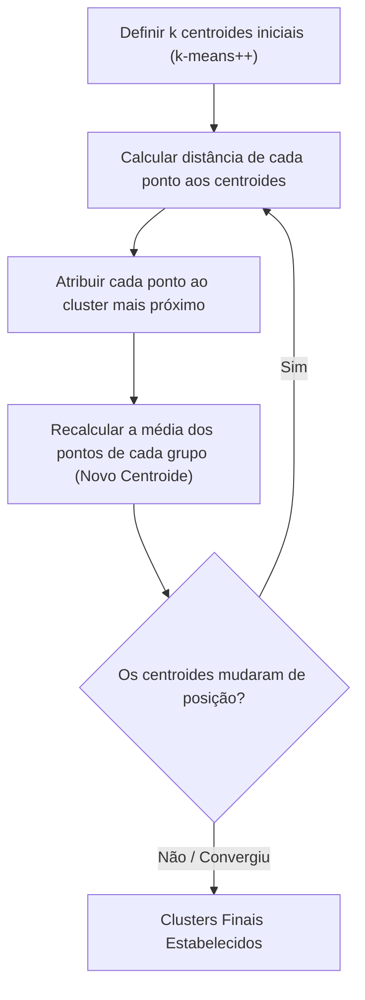

# 📘 UA05: Agrupamento e Métricas de Validação de Clusters

> [!abstract] **Objetivos de Aprendizagem (SAGAH)**
> - Processar e normalizar conjuntos de dados multidimensionais para tarefas de aprendizado não supervisionado (*clustering*).
> - Empregar o algoritmo **$k$-Means** para partição de dados em grupos coerentes e homogêneos.
> - Aplicar e interpretar métricas intrínsecas de validação de clusters (*Silhouette Score* e *Índice Calinski-Harabasz*).

---

## 📌 1. Introdução e Contextualização

Em muitas situações reais de negócio e engenharia de dados, não dispomos de dados previamente rotulados (*labels* ou gabaritos). É inviável ou proibitivamente caro rotular manualmente milhões de clientes bancários, leituras de sensores em tempo real ou perfis de navegação na web.

O **Agrupamento (*Clustering*)** é a principal técnica de **Aprendizado Não Supervisionado**. Seu objetivo é identificar padrões intrínsecos de similaridade geométrica ou estatística no espaço de atributos, agrupando instâncias afins em *clusters* de modo que elementos do mesmo grupo sejam muito semelhantes entre si (*alta coesão interna*) e muito distintos dos elementos de outros grupos (*alta separação externa*).

> **Princípio-Chave:** No agrupamento, o algoritmo não busca prever uma classe predeterminada, mas descobrir a topologia e as fronteiras naturais escondidas na distribuição dos dados.

---

## 🧬 2. Núcleo Conceitual (O "Como" e o "Porquê")

### 📍 O Algoritmo $k$-Means
O $k$-Means é um algoritmo iterativo baseado em partição por **centroides** (centros geométricos médios dos grupos). O processo ocorre em 4 etapas contínuas:

1. **Inicialização:** Define-se o número de grupos $k$ e sorteia-se $k$ posições iniciais para os centroides (a estratégia `init='k-means++'` acelera a convergência ao espalhar os centroides iniciais longe uns dos outros).
2. **Atribuição:** Cada ponto do dataset calcula a distância euclidiana até todos os centroides e é associado ao centroide mais próximo.
3. **Atualização:** O novo centroide de cada cluster é recalculado tirando a média das coordenadas de todos os pontos atribuídos a ele.
4. **Convergência:** As etapas 2 e 3 repetem-se até que os centroides parem de mudar de posição (ou atinja `max_iter`).



### ⚡ Otimização com Algoritmo de Elkan
No Scikit-Learn, a opção `algorithm='elkan'` utiliza a **desigualdade triangular** da geometria para evitar cálculos desnecessários de distância euclidiana entre pontos e centroides distantes, reduzindo o custo computacional e acelerando o processamento em grandes datasets. O uso de `n_jobs=-1` paraleliza o cálculo em todos os núcleos de CPU disponíveis.

---

### 📏 Métricas de Validação de Agrupamento

Como não há atributo-alvo para comparar acurácia, utilizam-se métricas de **validação interna**:

#### 1. Coeficiente de Silhueta (*Silhouette Score*)
Avalia a coesão interna ($a$) contra a separação do cluster vizinho mais próximo ($b$):
$$s = \frac{b - a}{\max(a, b)}$$
- **Varia de -1 a +1:**
  - Próximo de **+1**: Agrupamento excelente; amostras compactas e bem isoladas.
  - Em torno de **0**: Amostras na fronteira de transição entre dois grupos (sobreposição).
  - Próximo de **-1**: Amostras atribuídas ao grupo errado.

#### 2. Índice Calinski-Harabasz (*Variance Ratio Criterion*)
Razão entre a dispersão *entre clusters* (quanto mais longe melhor) e a dispersão *intra-cluster* (quanto mais compacto melhor).
- **Interpretação:** Quanto **MAIOR** o valor do índice Calinski-Harabasz, melhor e mais nítida é a formação dos clusters.

---

### 🌌 Analogia Feynman: Organizando Galáxias no Telescópio
> Imagine olhar para um mapa estelar com 10.000 pontos de luz sem rótulos:
> - O **$k$-Means** joga 4 alfinetes coloridos no mapa (os centroides).
> - Cada estrela ganha a cor do alfinete mais perto dela.
> - Em seguida, move-se cada alfinete exatamente para o centro de massa da sua constelação colorida.
> - Repete-se isso até que os alfinetes fiquem imóveis no núcleo exato das galáxias.
> 
> A **Silhueta** mede se cada estrela está realmente colada à sua galáxia ou perdida no vazio entre duas galáxias vizinhas.

---

## 📊 3. Síntese Comparativa das Métricas de Validação de Clusters

| Métrica | Faixa de Valores | Critério de Qualidade | Vantagem Principal |
| :--- | :--- | :--- | :--- |
| **Coeficiente de Silhueta** | $-1$ a $+1$ | Quanto **maior (mais próximo de 1)**, melhor. | Altamente intuitivo; avalia instâncias individualmente. |
| **Calinski-Harabasz** | $0$ a $+\infty$ | Quanto **maior**, melhor. | Cálculo extremamente rápido e eficiente para grandes bases. |
| **Davies-Bouldin** | $0$ a $+\infty$ | Quanto **menor (mais próximo de 0)**, melhor. | Mede a similaridade entre clusters (menor similaridade = melhor). |

---

## 🚀 4. Aplicação Prática: Treinamento de $k$-Means no Scikit-Learn

Configuração de alto desempenho para treinar 4 clusters com paralelismo e otimização de Elkan:

```python
import pandas as pd
from sklearn.cluster import KMeans
from sklearn.metrics import silhouette_score, calinski_harabasz_score

# 1. Carregamento dos dados
df = pd.read_csv("dados.csv", header=None, names=['A', 'B', 'C'])
X = df[['A', 'B']]  # Atributos previsores geométricos

# 2. Configuração otimizada do k-Means
kmeans = KMeans(
    n_clusters=4,
    init='k-means++',
    algorithm='elkan',  # Otimização por desigualdade triangular
    random_state=42
)
labels = kmeans.fit_predict(X)

# 3. Avaliação sem rótulos
print(f"Silhueta Média: {silhouette_score(X, labels):.4f}")
print(f"Calinski-Harabasz: {calinski_harabasz_score(X, labels):.2f}")
```

---

## 🎯 5. Dica do Professor (Foco em Provas)

> [!tip] **O que mais costuma cair em avaliações:**
> 1. **Métrica Sem Rótulos:** Em aprendizado não supervisionado, métricas como Acurácia, Matriz de Confusão ou F-Measure **não podem ser usadas** diretamente na ausência de classes conhecidas. A métrica padrão para avaliar clusters é a **Silhueta (*Silhouette*)** ou **Calinski-Harabasz**.
> 2. **Melhor Combinação de Índices:** Diante de opções comparando clusters, a melhor configuração é aquela que apresenta simultaneamente a **maior Silhueta (ex.: 0,7) e o maior Calinski-Harabasz (ex.: 1.500)**.
> 3. **Configuração para Reduzir Iterações e Cálculos:** Para usar todos os núcleos e reduzir distâncias calculadas, utiliza-se `n_jobs=-1` e `algorithm='elkan'`.

---

## 🧠 6. Questões de Fixação (Active Recall & SAGAH)

> **P1: O aprendizado não supervisionado descreve o conjunto de dados a partir de características intrínsecas a ele devido à falta de atributos-alvo. Nesses casos, qual métrica pode ser usada para avaliar o desempenho em tarefas de agrupamento?**  
> **Resposta Correta:** **a) Silhueta.**  
> 🎯 **Por quê?** A silhueta é uma métrica intrínseca que não depende de gabarito externo, calculando a razão entre a distância média intra-cluster e a distância para o cluster mais próximo.

---

> **P2: Dados os valores de silhueta e índice de Calinski-Harabasz abaixo, qual dos agrupamentos tem maior probabilidade de ter encontrado grupos válidos?**  
> a) Silhueta: -1; Calinski: 100  
> b) Silhueta: 0; Calinski: 50  
> c) Silhueta: 0,5; Calinski: 1.000  
> d) Silhueta: 0,7; Calinski: 1.500  
> e) Silhueta: 0,75; Calinski: 500  
> **Resposta Correta:** **d) Silhueta: 0,7. Calinski-Harabasz: 1.500.**  
> 🎯 **Por quê?** A opção D equilibra uma silhueta excepcionalmente alta (0,7) com o pico de separação e densidade global expresso pelo Calinski-Harabasz de 1.500.

---

> **P3: Assinale a linha de código que cria um objeto do algoritmo de k-means configurado para utilizar todos os núcleos de processamento disponíveis e reduzir a quantidade de cálculos de distância para convergir:**  
> **Resposta Correta:** **a) KMeans(3, n_jobs=-1, algorithm='elkan').**  
> 🎯 **Por quê?** O parâmetro `n_jobs=-1` aloca todas as threads da CPU em paralelo, enquanto o algoritmo `'elkan'` utiliza a desigualdade triangular para eliminar distâncias redundantes entre pontos e centroides.

---

> **P4: Ao avaliar quatro conjuntos de blobs artificiais (`make_blobs`) com k-Means e calcular o índice Calinski-Harabasz, qual critério define o conjunto com a melhor formação de clusters?**  
> **Resposta Correta:** O conjunto que atinge o maior valor numérico no índice Calinski-Harabasz (ex.: valor próximo de 768 a 857 dependendo da semente aleatória).  
> 🎯 **Por quê?** Como a fórmula de Calinski-Harabasz divide a dispersão entre grupos pela dispersão dentro dos grupos, quanto maior o resultado, mais compactos e isolados estão os agrupamentos.

---

## 📚 7. Referências e Conexões

- **KAUFMAN, L.; ROUSSEEUW, P. J.** *Finding groups in data: an introduction to cluster analysis*. New York: John Wiley & Sons, 2009.
- **TAN, P.-N.; STEINBACH, M.; KUMAR, V.** *Introdução ao Data Mining*. Rio de Janeiro: Ciência Moderna, 2009.
- Plataforma SAGAH: Unidade de Aprendizagem *Aprendizagem não supervisionada: algoritmos de agrupamento*.
- [[UA03 - Conceitos Básicos de Aprendizado de Máquina]]
- [[UA04 - Árvores de Decisão e Regressão com Scikit-Learn]]
