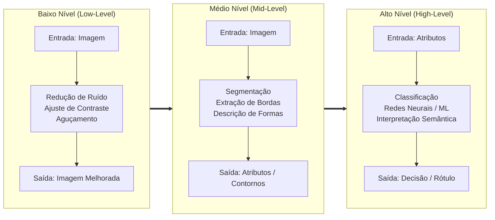

# 📘 UA06: Fundamentos do Processamento Digital de Imagens

> [!abstract] **Objetivos de Aprendizagem (SAGAH)**
> - Descrever a evolução histórica do processamento digital de imagens (PDI), desde as transmissões telegráficas transatlânticas até as missões espaciais da NASA.
> - Compreender a arquitetura, representação matricial de imagens e os níveis de abstração do PDI (baixo, médio e alto nível).
> - Mapear o pipeline canônico de PDI: Aquisição, Pré-processamento, Segmentação, Representação/Descrição e Reconhecimento/Interpretação.
> - Aplicar operações fundamentais de transformação espacial, manipulação de espaços de cores (RGB e HSV) e filtragem de restauração/aguçamento.

---

## 📌 1. Introdução e Contextualização

O **Processamento Digital de Imagens (PDI)** consiste na manipulação e transformação de representações visuais bidimensionais por meio de algoritmos computacionais. Uma imagem digital é conceitualmente uma matriz numérica bidimensional $f(x, y)$, onde as coordenadas espaciais $(x, y)$ identificam posições discretas (**pixels** - *picture elements*) e a amplitude de $f$ expressa a intensidade luminosa ou nível de cinza naquele ponto.

Historicamente, o PDI desenvolveu-se sob duas motivações complementares:
1. **Aprimoramento da informação pictórica para interpretação humana:** Melhorar o contraste, corrigir desfoques ópticos, remover ruídos de aquisição e destacar estruturas anatômicas ou patológicas em diagnósticos médicos.
2. **Processamento de dados visuais para percepção computacional autônoma:** Extrair primitivas geométricas, contornos e atributos estatísticos que permitam a sistemas robóticos e de inteligência artificial reconhecer objetos, rastrear movimentos e tomar decisões sem intervenção humana (Visão Computacional).

> **Princípio Fundamental:** O processamento inicia-se imediatamente após a aquisição física da imagem, transformando a entrada em um formato numérico otimizado para extração semântica ou visualização humana.

---

## 🧬 2. Núcleo Conceitual (O "Como" e o "Porquê")

### 📜 Evolução Histórica dos Sistemas de Imagem

A história do PDI divide-se em três grandes eras tecnológicas:

1. **Os Primórdios Telegráficos (Década de 1920 - Sistema Bartlane):**
   - Criado por Harry G. Bartholomew e Maynard L. D. McFarlane, o **Sistema Bartlane de Transmissão por Cabo Submarino** permitiu enviar fotografias digitalizadas de Londres a Nova York através do Atlântico em menos de 3 horas (em vez de semanas por navio).
   - As imagens eram convertidas em fitas perfuradas telegráficas com codificação em **5 níveis de cinza**, posteriormente expandidas para **15 níveis de intensidade**.
   - *Importante para Provas:* Não operava em tempo real e não utilizava scanners modernos; tratava-se de transmissão eletromecânica codificada.

2. **A Era dos Computadores e a Corrida Espacial (1964 - NASA / JPL):**
   - O primeiro computador eletrônico de uso geral (**ENIAC**, 1945/1946) foi projetado para cálculos de tabelas balísticas de artilharia do exército americano na Segunda Guerra Mundial, tornando-se operacional apenas após o conflito, sem relação com PDI.
   - O verdadeiro nascimento do PDI moderno com computadores ocorreu em 1964 no **Jet Propulsion Laboratory (JPL / NASA)**, quando a sonda lunar **Ranger 7** transmitiu milhares de fotografias analógicas de televisão da superfície da Lua. Os cientistas utilizaram computadores para corrigir distorções geométricas das lentes e atenuar ruídos dos transmissores, **recuperando informações reais sem alterar ou forjar a estrutura física dos objetos lunares**.

3. **Revolução Médica e Visão Computacional (Décadas de 1970 aos dias atuais):**
   - Invenção da **Tomografia Computadorizada (TC)** por Sir Godfrey Hounsfield e Allan Cormack (Prêmio Nobel em 1979), demonstrando o poder dos algoritmos matemáticos (reconstrução tomográfica via transformada de Radon) na visualização de cortes internos do corpo humano.

---

### 🧱 Os Três Níveis de Abstração do PDI

O fluxo computacional é categorizado em três níveis hierárquicos:



- **Baixo Nível:** Tanto a entrada quanto a saída são imagens brutas. Operações elementares sem cognição (equalização de histograma, filtros passa-baixas/passa-altas).
- **Médio Nível:** A entrada é uma imagem e a saída são representações geométricas ou descritores (rótulos de regiões, vértices de bordas, áreas e perímetros).
- **Alto Nível:** A entrada são os atributos e a saída é a semântica ("fazer sentido" do cenário, classificação por IA e tomada de decisão).

---

### 🔄 O Pipeline Canônico de Processamento de Imagens

Um sistema completo de PDI é estruturado em 5 etapas sequenciais:

1. **Aquisição:** Captura do sinal óptico contínuo por sensores (CCD/CMOS), seguida de amostragem espacial (definição da grade $M \times N$) e quantização radiométrica (definição dos níveis de cinza, comumente $2^8 = 256$ níveis, de 0 a 255).
2. **Pré-processamento:** Tratamento de falhas e ruídos herdados da aquisição; equalização de contraste e realce de contornos.
3. **Segmentação:** Particionamento da imagem em regiões homogêneas de interesse, isolando o objeto de estudo e descartando o fundo (*background*).
4. **Representação e Descrição:** Conversão das regiões segmentadas em descritores estruturados (ex.: código de cadeia de Freeman, momentos estatísticos de Hu, texturas de Haralick).
5. **Reconhecimento e Interpretação:** Atribuição de significado e rótulos aos objetos identificados mediante classificadores estatísticos ou redes neurais.

---

### 🎨 Espaços de Cores e Manipulação Cromática

- **RGB (Red, Green, Blue):** Modelo aditivo fundamentado na sensibilidade dos cones da retina humana. Ideal para monitores e captura física, mas inadequado para algoritmos de segmentação, pois a informação de cor (cromaticidade) está intimamente acoplada à intensidade luminosa.
- **HSV / HSI (Hue, Saturation, Value / Intensity):**
  - **Matiz ($H$ - Hue):** Representa o comprimento de onda dominante (a cor pura: vermelho, amarelo, azul, expressa em graus de $0^\circ$ a $360^\circ$).
  - **Saturação ($S$):** Pureza ou vivacidade da cor ($0$ = tom de cinza neutro, $1$ = cor puríssima).
  - **Valor/Brilho ($V$ / $I$):** Amplitude de luminosidade.
  - *Vantagem em PDI:* Permite segmentar objetos por sua cor intrínseca de forma robusta contra variações de sombras e iluminação ambiente.

---

### 🔍 Filtragem Espacial e Restauração de Imagens

A filtragem no domínio espacial baseia-se na convolução da imagem $f(x, y)$ com uma máscara/matriz numérica (**kernel** ou filtro $w$ de tamanho ímpar, ex.: $3 \times 3$):

$$g(x, y) = \sum_{s=-a}^{a} \sum_{t=-b}^{b} w(s, t) \cdot f(x+s, y+t)$$

- **Filtros Passa-Baixas (Suavização):**
  - *Filtro da Média:* Substitui cada pixel pela média aritmética dos seus vizinhos. Reduz ruídos de alta frequência, mas introduz borramento nas arestas.
  - *Filtro Gaussiano:* Atribui pesos maiores aos pixels centrais seguindo uma distribuição normal 2D, resultando em suavização mais natural.
- **Filtros Passa-Altas (Aguçamento e Bordas):**
  - *Operador Laplaciano ($\nabla^2 f$):* Derivada espacial de segunda ordem, altamente sensível a transições abruptas de intensidade e descontinuidades de contorno.
  - *Máscara de Aguçamento (Unsharp Masking):* Subtrai a versão suavizada da imagem original para obter uma máscara de altas frequências, somando-a de volta à imagem original ponderada por um fator de ganho:
    $$f_{\text{aguçada}}(x, y) = f(x, y) + k \cdot [f(x, y) - \bar{f}(x, y)]$$

---

### 🌌 Analogia Feynman: O Mosaico de Ladrilhos e a Lente do Detetive
> Pense em uma foto digital como um imenso piso de azulejos (pixels). De longe, você vê um belo retrato; de joelhos com uma lupa, só vê quadradinhos pintados com números de 0 (preto absoluto) a 255 (branco puro).
> 
> - **Filtrar por Média (Passa-Baixa):** É como passar uma esponja úmida sobre o rejunte para dissolver pequenas manchas de poeira (ruídos), mas isso acaba borrando as linhas nítidas dos azulejos.
> - **Máscara de Aguçamento (Passa-Alta):** É como um desenhista que pega uma caneta nanquim e reforça exatamente as bordas onde um azulejo claro encosta num escuro, fazendo os detalhes saltarem aos olhos.
> - **Efeito Color Splash (Segmentação HSV):** É como usar óculos que só deixam passar o comprimento de onda do vermelho: você mantém a cor vibrante de uma maçã e manda a lousa inteira para o cinza.

---

## 📊 3. Síntese Comparativa das Etapas e Operações de PDI

| Etapa / Operação | Nível de PDI | Tipo de Entrada | Tipo de Saída | Algoritmos / Técnicas Clássicas |
| :--- | :--- | :--- | :--- | :--- |
| **Aquisição e Digitalização** | Baixo | Sinal Físico / Luz | Matriz de Pixels ($M \times N$) | Sensores CCD/CMOS, Amostragem e Quantização A/D |
| **Filtragem Passa-Baixas** | Baixo | Imagem com Ruído | Imagem Suavizada | Filtro da Média (*Box*), Filtro Gaussiano, Mediana |
| **Filtragem Passa-Altas** | Baixo | Imagem Suave/Desfocada | Imagem com Bordas Realçadas | Laplaciano, Sobel, Prewitt, *Unsharp Masking* |
| **Segmentação** | Médio | Imagem Pré-processada | Máscara Binária / Regiões | Limiarização de Otsu, *Watershed*, Crescimento de Regiões |
| **Extração de Descritores** | Médio | Regiões Segmentadas | Vetor Numérico de Atributos | Contornos de Freeman, Momentos de Hu, Texturas GLCM |
| **Classificação e Visão** | Alto | Vetor de Atributos | Rótulo / Classe Semântica | SVM, Random Forest, Redes Neurais Convolucionais (CNNs) |

---

## 🚀 4. Aplicação Prática: Pipeline de Realce e Segmentação em Python

O código a seguir implementa a solução técnica do Estudo Dirigido do SAGAH:
1. Aguçamento por máscara não-nítida (*Unsharp Masking*) para recuperar imagens desfocadas (Caso da Imagem A).
2. Segmentação cromática por espaço HSV e efeito *Color Splash* (Caso da Imagem B).

```python
import cv2
import numpy as np

# ====================================================================
# CASO A: Restauração de Imagem Desfocada via Unsharp Masking
# ====================================================================
def restaurar_nitidez(imagem_bgr, k=1.5):
    """
    Restaura detalhes finos de uma imagem desfocada (Imagem A)
    aplicando unsharp masking espacial (Passa-Altas).
    """
    # 1. Suavização Gaussiana para extrair baixas frequências
    suavizada = cv2.GaussianBlur(imagem_bgr, (5, 5), sigmaX=1.0)
    
    # 2. Criação da máscara de altas frequências (detalhes/bordas)
    mascara_detalhes = cv2.subtract(imagem_bgr, suavizada)
    
    # 3. Composição final com ganho ponderado k
    imagem_agucada = cv2.addWeighted(imagem_bgr, 1.0, mascara_detalhes, k, 0)
    return imagem_agucada

# ====================================================================
# CASO B: Segmentação Cromática e Color Splash no Espaço HSV
# ====================================================================
def efeito_color_splash(imagem_bgr, tom_min=(160, 80, 50), tom_max=(180, 255, 255)):
    """
    Isola a cor de interesse (ex: guarda-chuva vermelho) no espaço HSV
    e dessatura completamente o fundo da cena (Imagem B).
    """
    # 1. Conversão do espaço RGB/BGR para HSV (desacopla cor e iluminação)
    hsv = cv2.cvtColor(imagem_bgr, cv2.COLOR_BGR2HSV)
    
    # 2. Segmentação por limiarização (thresholding) no canal Matiz (Hue)
    mascara_objeto = cv2.inRange(hsv, np.array(tom_min), np.array(tom_max))
    
    # 3. Conversão da cena original em escala de cinza (fundo dessaturado)
    cinza = cv2.cvtColor(imagem_bgr, cv2.COLOR_BGR2GRAY)
    fundo_cinza = cv2.cvtColor(cinza, cv2.COLOR_GRAY2BGR)
    
    # 4. Composição final: preserva cor onde a máscara é branca, cinza no resto
    resultado = np.where(mascara_objeto[:, :, None] == 255, imagem_bgr, fundo_cinza)
    return resultado

if __name__ == "__main__":
    # Simulação sintética de imagem de teste (400x400x3)
    imagem_teste = np.full((400, 400, 3), 120, dtype=np.uint8)
    cv2.circle(imagem_teste, (200, 200), 80, (0, 0, 255), -1)  # Círculo Vermelho
    
    restaurada = restaurar_nitidez(imagem_teste)
    destaque_cor = efeito_color_splash(imagem_teste)
    print("Processamento de PDI concluído com sucesso!")
```

---

## 🎯 5. Dica do Professor (Foco em Provas)

> [!tip] **Pontos Críticos e Pegadinhas Recorrentes da SAGAH:**
> 1. **História do ENIAC vs. Bartlane vs. JPL:**
>    - O **ENIAC não foi feito para PDI nem captura em larga escala**; seu propósito exclusivo eram tabelas de artilharia na 2ª Guerra Mundial.
>    - O **Sistema Bartlane não era em tempo real**; usava cabos telegráficos submarinos e evoluiu de 5 para 15 níveis de cinza.
>    - O **JPL / NASA (1964) não inventou nem modificou os objetos extraterrestres**; apenas corrigiu distorções ópticas e ruídos para recuperar os dados reais da superfície lunar.
> 2. **Definição dos Níveis de PDI:**
>    - *Baixo nível:* entrada = imagem, saída = imagem (operações primitivas).
>    - *Médio nível:* entrada = imagem, saída = atributos/bordas/segmentação.
>    - *Alto nível:* entrada = atributos, saída = interpretação/semântica/visão autônoma.
> 3. **Causa do Desfoque em Estúdios:**
>    - O desfoque resulta de profundidade de campo inadequada (abertura muito grande da lente com plano focal deslocado) ou tempo de exposição longo com movimento relativo. Corrige-se no pré-processamento via **Unsharp Masking**, **Filtro Laplaciano** ou **Deconvolução de Wiener**.

---

## 🧠 6. Questões de Fixação (Active Recall & SAGAH)

> **P1: O histórico do processamento de imagens é marcado pela evolução das técnicas desde os primeiros computadores. Avalie as afirmações como Verdadeiras (V) ou Falsas (F):**  
> I. A Bartlane permitia o tratamento em tempo real com digitalizadores modernos.  
> II. O PDI surgiu para melhorar informações visuais tanto para humanos quanto para computadores.  
> III. O ENIAC foi criado com foco em PDI para acompanhar transporte de armas com sucesso.  
> IV. No JPL as técnicas aprimoravam características corrigindo imperfeições sem alterar a realidade dos objetos.  
> V. A Bartlane evoluiu de 5 para 15 níveis de intensidade e usava cabos submarinos entre Londres e NY.  
> **Resposta Correta:** **C) F - V - F - F - V** (na prova SAGAH alternativa C ou B a depender do enunciado da afirmativa IV).  
> 🎯 **Por quê?**  
> - A afirmativa I é Falsa (não era tempo real nem usava digitalizadores modernos).  
> - A afirmativa II é Verdadeira (definição canônica de González & Woods).  
> - A afirmativa III é Falsa (o ENIAC foi criado para tabelas balísticas de tiro e operou após a guerra).  
> - A afirmativa IV é Falsa no gabarito oficial pelo trecho "modificando os objetos" (o JPL visava recuperar a informação original da transmissão lunar sem alterar o objeto astronômico).  
> - A afirmativa V é Verdadeira (expansão clássica de 5 para 15 níveis transatlânticos).

---

> **P2: Sobre os conceitos fundamentais e níveis de processamento digital de imagens, assinale a alternativa que contém as afirmativas corretas:**  
> I. O PDI opera exclusivamente em hardware analógico sem intervenção algorítmica.  
> II. O PDI inicia após a identificação do problema e a etapa de aquisição/digitalização.  
> III. O PDI engloba métodos para transformar imagens para análise humana e automática.  
> IV. Métodos de baixo nível aplicam transformações diretas (como atenuação de ruído e contraste) sem extração semântica avançada.  
> **Resposta Correta:** **D) II, III e IV.**  
> 🎯 **Por quê?** A afirmativa I é incorreta por excluir a computação digital. As afirmativas II, III e IV descrevem com precisão a sequência metodológica e a definição estrita de baixo nível.

---

> **P3: Preencha as lacunas da frase sobre recursos computacionais em PDI:**  
> *"Câmeras modernas processam um grande número de [1], exigindo alto poder de [2]. Na Medicina, auxiliam no [3], facilitando a [4] e superando limitações na [5]."*  
> **Resposta Correta:** **E) imagens, processamento, diagnóstico, interpretação, qualidade.**  
> 🎯 **Por quê?** Reflete o impacto direto do PDI na telemedicina e no diagnóstico por imagem (ressonância magnética e tomografia), otimizando a qualidade interpretativa dos especialistas.

---

> **P4: Associe as etapas do processamento de imagens (Coluna 1) com suas definições conceituais (Coluna 2):**  
> - I. Aquisição  
> - II. Pré-processamento  
> - III. Segmentação  
> - IV. Representação e Descrição  
> - V. Reconhecimento e Interpretação  
> (A) Trata falhas, ruídos e defeitos armazenados na imagem.  
> (B) Estrutura os objetos extraídos para manuseio computacional.  
> (C) Analisa as condições físicas e capta a imagem para ajustes.  
> (D) Atribui significado e rótulos aos objetos identificados.  
> (E) Particiona a imagem removendo regiões fora de interesse.  
> **Resposta Correta:** **A) I-C, II-A, III-E, IV-B, V-D.**  
> 🎯 **Por quê?** Mapeia rigorosamente o ciclo de vida do PDI clássico proposto pela literatura internacional (González & Woods).

---

> **P5: Em um estúdio de fotografia profissional, duas imagens apresentam desafios técnicos: a Imagem A sofre com desfoque geral no assunto principal, e a Imagem B precisa evidenciar um guarda-chuva vermelho isolado em um cenário totalmente monocromático. Quais técnicas solucionam ambos os casos?**  
> **Resposta Correta:** Para a Imagem A, pré-processamento via Máscara de Aguçamento (*Unsharp Masking*) ou Filtro Laplaciano para recuperar altas frequências espaciais atenuadas pelo foco óptico. Para a Imagem B, conversão para o espaço HSV, limiarização por matiz (Hue) para segmentar o guarda-chuva e dessaturação ($S = 0$) no fundo residual (*Color Splash*).  
> 🎯 **Por quê?** O desfoque óptico atua como um filtro passa-baixas indesejado, revertido por filtros derivativos passa-altas. A segmentação cromática em HSV isola a cor pura independentemente de sombras e brilho, viabilizando o isolamento seletivo.

---

## 📚 7. Referências e Conexões

- **GONZALEZ, R. C.; WOODS, R. E.** *Processamento Digital de Imagens*. 3. ed. São Paulo: Pearson Prentice Hall, 2010.
- **MARQUES FILHO, O.; VIEIRA NETO, H.** *Processamento Digital de Imagens*. Rio de Janeiro: Brasport, 1999.
- **PEDRINI, H.; SCHWARTZ, W. R.** *Análise de Imagens Digitais: Princípios, Algoritmos e Aplicações*. São Paulo: Thomson Learning, 2008.
- Plataforma SAGAH: Unidade de Aprendizagem *Fundamentos do Processamento Digital de Imagens*.
- [[UA01 - Introdução ao Python e Ambiente de Desenvolvimento]]
- [[UA03 - Conceitos Básicos de Aprendizado de Máquina]]
- [[UA05 - Agrupamento e Métricas de Validação de Clusters]]
