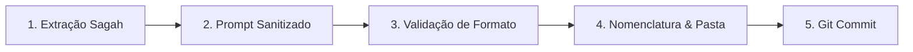

# 📘 Guia de Padronização e Gestão de Conhecimento: Resumos Sagah & Obsidian

Este documento consolida o diagnóstico técnico, a arquitetura de informação e as diretrizes oficiais para padronização dos resumos de estudos, notas acadêmicas e Unidades de Aprendizagem (UAs) da plataforma SAGAH dentro deste repositório e vault do Obsidian.

---

## 📑 Sumário Executivo

1. [Diagnóstico do Repositório & Auditoria Técnica](#1-diagnóstico-do-repositório--auditoria-técnica)
2. [Arquitetura de Pastas e Convenção de Nomenclatura](#2-arquitetura-de-pastas-e-convenção-de-nomenclatura)
3. [Taxonomia e Metadados (Frontmatter YAML)](#3-taxonomia-e-metadados-frontmatter-yaml)
4. [Template Padrão em Markdown: Golden Standard (Sagah / Exames)](#4-template-padrão-em-markdown-golden-standard-sagah--exames)
5. [Template Secundário: Ensaio Teórico & Design de Games](#5-template-secundário-ensaio-teórico--design-de-games)
6. [Checklist Operacional para Novos Resumos](#6-checklist-operacional-para-novos-resumos)
7. [Guia de Boas Práticas e Regras de Higienização de IA](#7-guia-de-boas-práticas-e-regras-de-higienização-de-ia)

---

## 1. Diagnóstico do Repositório & Auditoria Técnica

O repositório funciona como uma base de conhecimento pessoal no Obsidian, armazenando o processamento de Unidades de Aprendizagem (UAs) do Sagah e disciplinas acadêmicas. A auditoria identificou forças didáticas expressivas, acompanhadas de inconsistências de nomenclatura e ausência de metadados.

### 1.1 Matriz de Diagnóstico e Plano de Ação

| Dimensão | Situação Encontrada | Diagnóstico & Impacto | Ação Corretiva Recomendada |
| :--- | :--- | :--- | :--- |
| **Hierarquia de Pastas** | Divisão por ano (`2025/`, `2026/`) com disciplinas dentro. | Arquivos soltos fora de disciplinas (`2026/Bem-vindo.md`, `atividade 08 IOT...` na raiz de `2026`). Pasta com nome de docente (`IoT Rafael`). | Mover notas órfãs para as respectivas disciplinas. Padronizar disciplinas sem nomes de professores (`Internet-das-Coisas/`). |
| **Configuração Obsidian** | Pastas `.obsidian` na raiz e duplicada em `2026/.obsidian`. | Conflito de indexação e duplicação de plugins/espaços de trabalho. | Manter apenas o `.obsidian` raiz do vault; remover `2026/.obsidian`. |
| **Nomenclatura de Arquivos** | 3 convenções concorrentes (`001 2° Ciclo...`, `atividade -5 IOT...`, `Teoria...`). | Dificuldade de ordenação cronológica e erros de digitação (`-5` e `-6` em vez de `05` e `06`). | Adotar o padrão canônico: `UA{NN} - {Titulo-Do-Topico}.md`. |
| **Frontmatter (YAML)** | Ausente em 96% dos arquivos. Presente apenas em 1 arquivo (com conteúdo trocado). | Inviabiliza consultas com *Dataview*, rastreio de ciclos, datas e busca facetada por tags. | Impor bloco YAML padronizado obrigatório no início de cada documento. |
| **Resíduos de IA** | Saudações e diálogos de LLM deixados nos resumos (*"Com certeza! Analisei..."*, *"Excelente escolha usar o Obsidian"*). | Poluição visual e perda de tom profissional nas notas. | Aplicar regra de sanitização prévia antes de salvar as notas. |
| **Qualidade da Síntese** | Excelente uso da Técnica Feynman, analogias do dia a dia e FAQs de fixação. | Alta capacidade de retenção para exames e provas acadêmicas. | Preservar e institucionalizar a seção de *Active Recall* e analogias no template mestre. |

---

## 2. Arquitetura de Pastas e Convenção de Nomenclatura

### 2.1 Estrutura Canônica de Diretórios

```text
.
├── .obsidian/                     # Configurações globais do vault
├── README.md                      # Apresentação do repositório
├── GUIA_PADRONIZACAO.md           # Este manual de governança
│
├── 2025/
│   ├── Banco-de-Dados/
│   ├── Desenvolvimento-Mobile/
│   └── Metodologia-Agil/
│
└── 2026/
    ├── Desenvolvimento-de-Games/
    └── Internet-das-Coisas/       # Substitui a pasta 'IoT Rafael'
```

### 2.2 Regras de Nomenclatura

* **Pastas de Disciplinas:** Formato descritivo formal em português, usando hífens para separar palavras (Kebab-Case) ou espaçamento uniforme sem nomes de professores.
  * Correto: `Governança-de-TI/`, `Desenvolvimento-Mobile/`
  * Incorreto: `IoT Rafael/`, `Metodologia Agil` (sem acento/sem padrão)
* **Subpastas de Módulos / Unidades:**
  * Padrão oficial: `UA{NN} - {Nome da Matéria/Tópico}/`
  * ❌ **Proibido:** Nomes opacos e genéricos como `AU01/`, `AU02/`, `Atividade 1/`.
  * ✔ **Obrigatório:** Substituir sempre pelo identificador canônico e o nome da matéria/tópico (ex: `UA01 - Fatores Motivadores da Governança de TI/`, `UA02 - Mecanismos de Decisão em TI/`).
* **Arquivos de Unidades SAGAH:**
  * Padrão oficial: `UA{NN} - {Nome do Tópico}.md`
  * O identificador deve sempre conter 2 dígitos (`UA01`, `UA02`, ..., `UA12`).
  * Exemplos corretos:
    * `UA03 - Introdução aos Sistemas Embarcados.md`
    * `UA05 - Arquiteturas de Processadores ARM.md`
    * `UA08 - Sistemas Operacionais Embarcados em Tempo Real.md`
  * Exemplos incorretos:
    * ❌ `atividade -5 IOT - ...md` (hífen substituindo zero)
    * ❌ `003 2° Ciclo -Banco de Dados.md` (falta de espaço após hífen)
    * ❌ `AU01.md` / `Sem título.md` (falta de identificação temático)

---

## 3. Taxonomia e Metadados (Frontmatter YAML)

Todas as notas devem iniciar obrigatoriamente com o bloco delimitador `---` contendo os metadados abaixo:

```yaml
---
disciplina: "Internet das Coisas"
ciclo: "1° Ciclo"
ano: 2026
unidade_sagah: 8
titulo: "Sistemas Operacionais Embarcados em Tempo Real"
data_criacao: 2026-10-12
status: "Concluído" # Rascunho | Revisão | Concluído
tags:
  - faculdade/iot
  - tipo/resumo-sagah
  - topico/rtos
  - topico/sistemas-embarcados
---
```

### 3.1 Dicionário de Campos

| Campo | Tipo | Obrigatoriedade | Descrição | Exemplo |
| :--- | :--- | :--- | :--- | :--- |
| `disciplina` | Texto | Obrigatório | Nome padronizado da disciplina | `"Banco de Dados"` |
| `ciclo` | Texto | Obrigatório | Ciclo ou semestre acadêmico | `"2° Ciclo"` |
| `ano` | Inteiro | Obrigatório | Ano de realização do estudo | `2026` |
| `unidade_sagah`| Inteiro | Opcional | Número da UA do SAGAH correspondente | `8` |
| `titulo` | Texto | Obrigatório | Nome completo e canônico da temática | `"Álgebra Relacional"` |
| `data_criacao` | Data (AAAA-MM-DD) | Obrigatório | Data em que a nota foi produzida | `2026-10-12` |
| `status` | Enum | Obrigatório | Estado de completude da nota | `"Concluído"` |
| `tags` | Lista de Strings | Obrigatório | Tags aninhadas (*nested tags*) | `[faculdade/bd, tipo/resumo]` |

### 3.2 Taxonomia de Tags Recomendada

* **Hierarquia por Disciplina:** `#faculdade/banco-de-dados`, `#faculdade/mobile`, `#faculdade/iot`, `#faculdade/games`, `#faculdade/metodologia-agil`
* **Hierarquia por Tipo:** `#tipo/resumo-sagah`, `#tipo/exercicio`, `#tipo/moc`, `#tipo/ensaio`
* **Hierarquia por Status:** `#status/concluido`, `#status/revisao`, `#status/rascunho`
* **Hierarquia por Tópico Específico:** `#topico/rtos`, `#topico/arm`, `#topico/acid`, `#topico/sql`, `#topico/scrum`

---

## 4. Template Padrão em Markdown: Golden Standard (Sagah / Exames)

Utilize este modelo para resumos orientados a disciplinas técnicas, exames e atividades do SAGAH:

```markdown
---
disciplina: "Nome da Disciplina"
ciclo: "1° Ciclo"
ano: 2026
unidade_sagah: 1
titulo: "Título Oficial da Unidade de Aprendizagem"
data_criacao: 2026-10-12
status: "Concluído"
tags:
  - faculdade/nome-disciplina
  - tipo/resumo-sagah
  - topico/conceito-principal
---

# 📘 UA01: Título Oficial da Unidade de Aprendizagem

> [!abstract] **Objetivos de Aprendizagem (SAGAH)**
> - [Objetivo 1 extraído da introdução da UA]
> - [Objetivo 2 extraído da introdução da UA]
> - [Objetivo 3 extraído da introdução da UA]

---

## 📌 1. Introdução e Contextualização
Apresente aqui o problema prático e o cenário que justifica a existência deste tema. Explique por que um profissional da área precisa dominar este conhecimento.

> **Princípio-Chave:** [Definição central em uma ou duas frases de alto impacto e memorização rápida].

---

## 🧬 2. Núcleo Conceitual (O "Como" e o "Porquê")

### 🧠 Conceito Principal 1
Explicação detalhada do conceito. Use a **Técnica Feynman** para criar uma analogia simples com o mundo real.

* **Analogia Didática:** Pense neste mecanismo como [Analogia com biblioteca, motor de carro, almoxarifado, etc.].
* **Pontos de Atenção:**
  * ✔ Boa prática / recomendação técnica
  * ⚠ Ponto crítico / restrição de arquitetura

### ⚙️ Detalhamento Técnico e Arquitetura
Aprofundamento sobre como o conceito opera internamente no sistema, hardware ou código.

---

## 📊 3. Síntese Comparativa

| Critério / Recurso | Abordagem A (ex: CISC / GPOS) | Abordagem B (ex: RISC / RTOS) |
| :--- | :--- | :--- |
| **Definição / Foco** | [Propósito principal da abordagem A] | [Propósito principal da abordagem B] |
| **Determinismo / Desempenho** | [Comportamento temporal ou de memória] | [Comportamento temporal ou de memória] |
| **Custo / Complexidade** | [Nível de complexidade / recursos] | [Nível de complexidade / recursos] |

---

## 🚀 4. Aplicações Práticas & Casos de Uso
* **Mercado / Indústria:** Como este conceito se materializa no ambiente profissional ou fabril.
* **Exemplo Concreto:** [Estudo de caso, diagrama ou trecho ilustrativo].

---

## 🎯 5. Dica do Professor (Foco em Avaliações)
> [!tip] **O que mais costuma cair na prova:**
> 1. Diferença fundamental entre [Termo A] e [Termo B].
> 2. Cenários em que o uso de [Tecnologia X] é obrigatório versus opcional.
> 3. Pegadinha frequente de exame: [Cuidado com terminologia ou pegadinha conceitual].

---

## 🧠 6. Questões de Fixação (Active Recall)

> **P1: [Pergunta direta sobre a essência do conceito]?**  
> **Resposta:** [Resposta explicativa e direta].  
> 🎯 **Por quê?** [Justificativa técnica].

> **P2: [Pergunta com alternativas no padrão da prova do SAGAH]?**  
> **Resposta Correta:** Alternativa [X] — [Texto da alternativa correta].  
> 🎯 **Por quê?** [Explicação da alternativa correta e o motivo pelo qual as demais são falsas].

---

## 📚 7. Referências e Conexões
- SAGAH: Unidade de Aprendizagem [Título da Unidade].
- [[Nota Relacionada 1]]
- [[Nota Relacionada 2]]
```

---

## 5. Template Secundário: Ensaio Teórico & Design de Games

Utilize este modelo para disciplinas conceituais, ensaios de design, ludologia ou metodologias:

```markdown
---
disciplina: "Desenvolvimento de Games"
ciclo: "1° Ciclo"
ano: 2026
titulo: "Teoria da Tétrade Elementar"
data_criacao: 2026-10-12
status: "Concluído"
tags:
  - faculdade/games
  - tipo/ensaio
  - topico/game-design
---

# 🎮 Teoria da Tétrade Elementar

## 📌 Introdução e Contextualização
Contextualização histórica e definição ontológica do conceito dentro do escopo da disciplina.

---

## 🧬 Núcleo Teórico (O "Como" e o "Porquê")
Apresentação aprofundada dos pilares conceituais:
- **⚙️ Mecânica:** Regras, verbos e sistemas.
- **🎨 Estética:** Aspectos sensoriais e imersão.
- **📖 Narrativa:** Contexto ficcional e arco dramático.
- **💻 Tecnologia:** Suporte físico e infraestrutura técnica.

> **O Paradigma Central:** [Síntese da interdependência dos pilares].

---

## ⚖️ Complexidades e Paradoxos
Discussão de tensões teóricas e desafios práticos de implementação (ex: paradoxos de balanceamento, dissonância ludonarrativa).

---

## 🚀 Aplicações e Exemplos Reais
Análise de casos práticos e obras consagradas no mercado:
- **Caso 1:** Análise de mecânicas e impacto na experiência do usuário.
- **Caso 2:** Crossover transmídia ou cultura pop.

---

## 📚 Fontes e Referências Sugeridas
- **SOBRENOME, Nome.** *Título da Obra*. Cidade: Editora, Ano.
- [[Conceito Relacionado]]
```

---

## 6. Checklist Operacional para Novos Resumos



### Passo 1: Extração do Material SAGAH
- [ ] Copiar os **Objetivos de Aprendizagem** da introdução da UA.
- [ ] Mapear o **Infográfico** para a tabela comparativa.
- [ ] Extrair o **Conteúdo Teórico** (Livro) identificando pelo menos 1 analogia didática.
- [ ] Separar a **Dica do Professor** e as **5 Questões de Fixação** com gabarito comentado.

### Passo 2: Geração e Higienização com IA
- [ ] No prompt do LLM, exigir estritamente: *"Forneça apenas o Markdown limpo, sem saudações, introduções conversacionais ou comentários finais"*.
- [ ] Conferir se o arquivo começa na **Linha 1** com `---` do YAML (sem linhas em branco ou separadores triplos antes).
- [ ] Garantir que nenhuma fala residual de assistente permaneceu no texto.

### Passo 3: Nomenclatura e Arquitetura de Pastas
- [ ] Salvar dentro da pasta correta: `YYYY/Nome-Da-Disciplina/`.
- [ ] Nomear o arquivo seguindo rigorosamente o padrão: `UA{NN} - {Nome da Aula}.md`.
- [ ] Confirmar que o número possui 2 dígitos (ex: `UA04`, nunca `atividade -4`).

### Passo 4: Validação no Obsidian
- [ ] Verificar se as tags foram reconhecidas pelo painel de tags do Obsidian.
- [ ] Conferir se os Callouts (`> [!abstract]`, `> [!tip]`) renderizam corretamente.
- [ ] Criar no mínimo 2 links bidirecionais `[[...]]` para conectar a nota a conceitos correlatos.

### Passo 5: Versionamento Git
- [ ] Executar o commit seguindo o padrão de Conventional Commits:
  ```bash
  git add "2026/Internet-das-Coisas/UA08 - Sistemas Operacionais Embarcados em Tempo Real.md"
  git commit -m "docs(iot): adicionar resumo da UA08 sobre RTOS"
  git push origin main
  ```

---

## 7. Guia de Boas Práticas e Regras de Higienização de IA

### 7.1 Regras de Estilo Tipográfico
1. **Hierarquia Semântica:** O título principal deve usar `#`. Grandes seções utilizam `##` com numeração (`1.`, `2.`, `3.`), e subtópicos atômicos utilizam `###`.
2. **Negrito para Leitura Diagonal:** Destaque em **negrito** os termos técnicos, definições críticas e conclusões de raciocínio.
3. **Uso Estratégico de Emojis:** Utilize emojis como âncoras visuais padronizadas nos cabeçalhos (`📘`, `📌`, `🧬`, `📊`, `🚀`, `🎯`, `🧠`, `📚`).
4. **Callouts Nativos do Obsidian:** Priorize callouts do Obsidian em vez de blocos de citação comuns:
   * `> [!abstract]` para objetivos e sumários.
   * `> [!tip]` para dicas de prova e atalhos de estudo.
   * `> [!warning]` para restrições técnicas, armadilhas conceituais e erros comuns.

### 7.2 Higienização de Resíduos de IA
Nunca inclua em commits os seguintes padrões identificados em versões anteriores:
* ❌ *"Excelente escolha usar o Obsidian!..."*
* ❌ *"Com certeza! Preparei um resumo completo..."*
* ❌ *"Claro, aqui está o mesmo resumo formatado como texto contínuo..."*
* ❌ Múltiplos divisores seguidos (`---\n---\n---`).
* ❌ Notas sem título ou vazias (`Sem título.md`).
