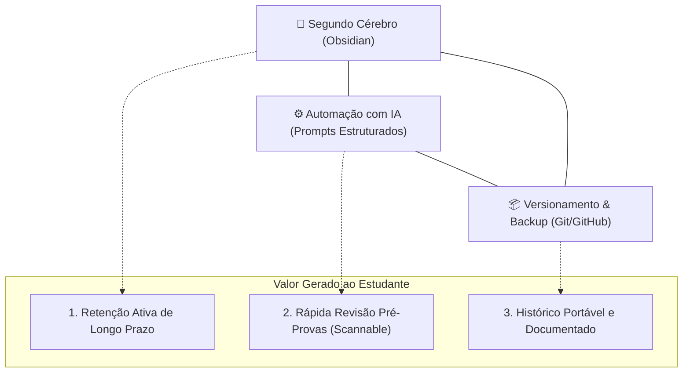
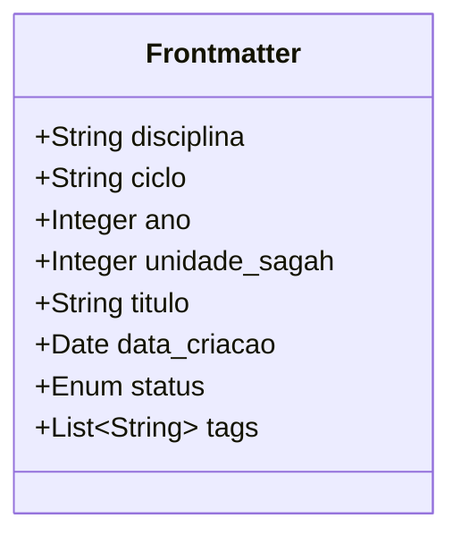
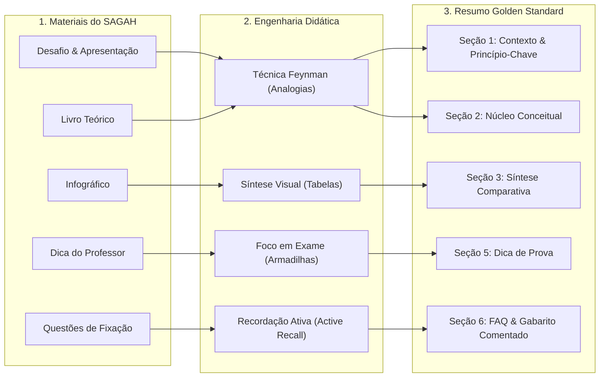
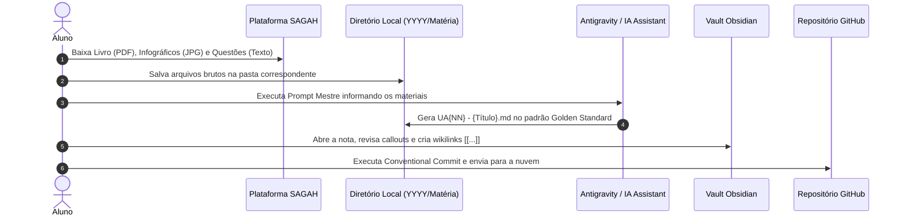

# 📚 Manual de Operação e Documentação de Ponta a Ponta
## Repositório de Estudos Acadêmicos, Resumos SAGAH & Obsidian Vault

---

## 📑 Sumário

1. [Visão Geral e Propósito do Sistema](#1-visão-geral-e-propósito-do-sistema)
2. [Arquitetura da Informação e Estrutura de Diretórios](#2-arquitetura-da-informação-e-estrutura-de-diretórios)
3. [Especificação de Metadados e Frontmatter YAML](#3-especificação-de-metadados-e-frontmatter-yaml)
4. [Painéis e Consultas Dinâmicas no Obsidian (Dataview)](#4-painéis-e-consultas-dinâmicas-no-obsidian-dataview)
5. [Metodologia Pedagógica e Engenharia Didática](#5-metodologia-pedagógica-e-engenharia-didática)
6. [Catálogo de Templates Oficiais](#6-catálogo-de-templates-oficiais)
7. [Fluxo Operacional de Ponta a Ponta (Pipeline do Aluno)](#7-fluxo-operacional-de-ponta-a-ponta-pipeline-do-aluno)
8. [Engenharia de Prompt para IA (Sanitização e Geração)](#8-engenharia-de-prompt-para-ia-sanitização-e-geração)
9. [Estudo de Caso Prático: Da Matéria Bruta ao Resumo Final](#9-estudo-de-caso-prático-da-matéria-bruta-ao-resumo-final)
10. [Plano de Migração de Notas Legadas e Manutenção](#10-plano-de-migração-de-notas-legadas-e-manutenção)
11. [Troubleshooting & Perguntas Frequentes](#11-troubleshooting--perguntas-frequentes)

---

## 1. Visão Geral e Propósito do Sistema

### 1.1 Contexto e Justificativa
Este repositório foi concebido para atuar como o **Segundo Cérebro (PKM - Personal Knowledge Management)** do estudante, centralizando a documentação de disciplinas da graduação em Tecnologia, anotações de aula e, prioritariamente, o processamento analítico das **Unidades de Aprendizagem (UAs) da plataforma SAGAH**.

A plataforma SAGAH entrega conteúdos educacionais compostos por teoria densa, infográficos, desafios e questões de autoavaliação. Sem um método estruturado de consolidação, esse conhecimento corre o risco de fragmentação e esquecimento. Este repositório resolve esse desafio ao transformar conteúdos brutos em **resumos sintetizados, hiperconectados e visualmente escaneáveis**, hospedados no Obsidian e versionados no GitHub.

### 1.2 Os Três Pilares do Sistema



1. **Obsidian (Grafo de Conhecimento):** Utilização de Markdown com links bidirecionais (`[[...]]`), callouts nativos, tabelas e tags para conectar conceitos transversais entre disciplinas (ex: Sistemas Operacionais ➔ RTOS ➔ IoT).
2. **Automação Controlada por IA:** Processamento de textos de livros, infográficos e questões do SAGAH através de regras estritas de engenharia de prompt, garantindo que o conteúdo final saia limpo, pedagógico e sem poluição conversacional.
3. **Controle de Versão (Git):** Rastreabilidade histórica de todas as alterações, sincronização em nuvem e segurança contra perda de dados.

---

## 2. Arquitetura da Informação e Estrutura de Diretórios

### 2.1 Visão Global da Árvore de Arquivos
A organização do repositório adota uma abordagem **Crono-Temática**: o primeiro nível representa o ano letivo, o segundo nível agrupa as disciplinas canônicas, e o terceiro nível acomoda as notas de aula acompanhadas de uma subpasta isolada para arquivos estáticos (`assets/`).

```text
.
├── .obsidian/                                  # Configurações globais e plugins do vault
├── doc/                                        # Documentação de governança de ponta a ponta
│   ├── README.md                               # Este manual completo
│   ├── GUIA_PADRONIZACAO.md                    # Guia rápido de regras e checklist
│   ├── PROMPT_CRIACAO_RESUMOS.md               # Prompt mestre para geração via IA
│   └── DOCUMENTACAO_SISTEMA_ESTUDOS.docx       # Versão formal executiva (.docx)
├── README.md                                   # Apresentação do repositório para o GitHub
│
├── 2025/                                       # Ciclos letivos de 2025
│   ├── Banco-de-Dados/
│   ├── Desenvolvimento-Mobile/
│   └── Metodologia-Agil/
│
└── 2026/                                       # Ciclos letivos de 2026
    ├── Algoritmos-e-Complexidade/              # Teoria da computação, paralelismo e ordenação
    │   ├── UA01 - Modelos de Computação e Eficiência de Algoritmos/
    │   ├── UA02 - Divisão e Conquista em Programação Paralela/
    │   └── UA03 - Métodos de Ordenação Interna de Dados/
    ├── Inteligencia-Artificial/                # Ecossistema Python, ML clássico, clustering e PDI
    │   ├── UA01 - Introdução ao Python e Ambiente de Desenvolvimento/
    │   ├── UA02 - Funções e Programação Orientada a Objetos em Python/
    │   ├── UA03 - Conceitos Básicos de Aprendizado de Máquina/
    │   ├── UA04 - Árvores de Decisão e Regressão com Scikit-Learn/
    │   ├── UA05 - Agrupamento e Métricas de Validação de Clusters/
    │   └── UA06 - Fundamentos do Processamento Digital de Imagens/
    ├── Governança-de-TI/                       # Governança corporativa, COBIT, ITIL e LGPD
    │   ├── assets/                             # Recursos visuais locais da disciplina
    │   │   └── 7d6a6736-3441-4877-8383-33dffa234cc0.jpg
    │   ├── UA01 - Fatores Motivadores da Governança de TI/
    │   │   ├── CONTEÚDOS DO SAGAH.txt
    │   │   ├── PDF.js viewer.pdf
    │   │   └── UA01 - Fatores Motivadores da Governança de TI.md
    │   ├── UA02 - Mecanismos de Decisão em TI/
    │   ├── UA03 - Objetivos Normas e Boas Práticas/
    │   ├── UA04 - Alinhamento Estratégico e Planejamento de TI/
    │   ├── UA05 - Projeto de Governança de TI/
    │   └── UA06 - Regulamentações da Governança em TI/
    ├── Desenvolvimento-de-Games/
    └── IoT Rafael/                             # Sistemas embarcados, ARM, RTOS e microcontroladores
```

### 2.2 Padrão Canônico de Nomenclatura

| Elemento | Padrão Oficial | Exemplo Válido | Exemplos Inválidos (Evitar) |
| :--- | :--- | :--- | :--- |
| **Pastas de Ano** | `YYYY/` | `2025/`, `2026/` | `Ano 2026/`, `2026-1/` |
| **Pastas de Disciplina**| `Nome-Da-Disciplina/` (Kebab-Case com iniciais maiúsculas ou espaços uniformes, sem nomes de docentes) | `Governança-de-TI/`, `Internet-das-Coisas/` | `IoT Rafael/` *(nome de professor)*, `Metodologia Agil` *(sem acento)* |
| **Subpastas de UAs** | `UA{NN} - {Nome da Matéria/Tópico}/` | `UA01 - Fatores Motivadores da Governança de TI/` | `AU01/`, `AU02/`, `Atividade 1/` *(opacos e genéricos)* |
| **Arquivos SAGAH** | `UA{NN} - {Título da Atividade}.md` (sempre 2 dígitos) | `UA01 - Arquitetura de Banco de Dados.md`, `UA08 - Sistemas RTOS.md` | `atividade -5 IOT...` *(typo com hífen)*, `003 2° Ciclo -Banco...` *(espaço irregular)* |
| **Arquivos Teóricos** | `{Nome Conceitual do Tema}.md` | `Teoria da Tétrade Elementar.md` | `Sem título.md`, `resumo_novo.md` |
| **Pastas de Mídia** | `assets/` dentro da respectiva disciplina | `2026/Governança-de-TI/assets/` | Arquivos de imagem soltos na raiz de `2026/` |

### 2.3 Regra de Eliminação de Prefixos Genéricos (`AU0X` ➔ `UA{NN} - {Nome do Tópico}`)
> [!important] **Diretriz Obrigatória de Nomenclatura de Pastas e Módulos:**
> - **NUNCA** nomeie pastas ou arquivos de unidades apenas com siglas opacas como `AU01`, `AU02`, `Atividade 1` ou `Modulo 2`.
> - **SEMPRE** substitua o padrão genérico pelo identificador canônico de dois dígitos seguido do nome real da matéria ou do tópico estudado: `UA{NN} - {Nome da Matéria/Tópico}`.
> - **Por que essa regra existe?**
>   1. **Busca Global e Quick Switcher (`Ctrl + O`):** No Obsidian, pastas e notas com títulos descritivos aparecem instantaneamente ao digitar termos da matéria (ex: *"Mecanismos de Decisão"*), enquanto códigos opacos (`AU02`) forçam o aluno a memorizar números.
>   2. **Prevenção de Ambiguidade:** Evita confusão entre disciplinas distintas que poderiam ter pastas com o mesmo código `AU01`.
>   3. **Legibilidade no GitHub:** Permite que qualquer pessoa ou ferramenta navegando pela árvore web compreenda imediatamente o conteúdo sem precisar abrir cada subpasta.

---

## 3. Especificação de Metadados e Frontmatter YAML

O uso de metadados estruturados no topo das notas (YAML Frontmatter) é **obrigatório**. Ele permite consultas automatizadas via plugins, categorização precisa no painel do Obsidian e interoperabilidade com outras ferramentas de gestão de conhecimento.

### 3.1 Bloco YAML Canônico
Toda nota deve começar exatamente na **Linha 1** com:

```yaml
---
disciplina: "Governança de TI"
ciclo: "1° Ciclo"
ano: 2026
unidade_sagah: 1
titulo: "Os Fatores Motivadores da Governança de TI"
data_criacao: 2026-10-12
status: "Concluído" # Rascunho | Revisão | Concluído
tags:
  - faculdade/governanca-de-ti
  - tipo/resumo-sagah
  - topico/governanca-ti
  - topico/sistemas-de-informacao
---
```

### 3.2 Dicionário Detalhado de Campos



1. **`disciplina` (String, Obrigatório):** Nome exato da matéria acadêmica. Permite agrupamento em relatórios.
2. **`ciclo` (String, Obrigatório):** Semestre ou módulo acadêmico (ex: `"1° Ciclo"`, `"2° Ciclo"`).
3. **`ano` (Inteiro, Obrigatório):** Ano cronológico da realização do estudo (ex: `2026`).
4. **`unidade_sagah` (Inteiro, Opcional/Recomendado):** Número sequencial da Unidade de Aprendizagem do SAGAH (ex: `1`, `8`).
5. **`titulo` (String, Obrigatório):** Título formal e completo do tema trabalhado.
6. **`data_criacao` (Data AAAA-MM-DD, Obrigatório):** Data em que o resumo foi concluído.
7. **`status` (Enum, Obrigatório):** Estado do documento:
   - `"Rascunho"`: Nota incompleta ou em fase de digitação.
   - `"Revisão"`: Nota finalizada, pendente de validação antes de exames.
   - `"Concluído"`: Nota polida, testada e pronta para consultas.
8. **`tags` (Lista, Obrigatório):** Tags aninhadas com barra (`/`) que alimentam a taxonomia do vault.

### 3.3 Taxonomia de Tags Aninhadas (Nested Tags)

```text
#faculdade/
  ├── banco-de-dados
  ├── desenvolvimento-mobile
  ├── governanca-de-ti
  ├── internet-das-coisas
  └── games

#tipo/
  ├── resumo-sagah
  ├── exercicio
  ├── moc (Map of Content)
  └── ensaio

#status/
  ├── concluido
  ├── revisao
  └── rascunho

#topico/
  ├── rtos
  ├── arm
  ├── acid
  ├── sql
  └── matriz-applegate
```

---

## 4. Painéis e Consultas Dinâmicas no Obsidian (Dataview)

Com a padronização do Frontmatter, você pode utilizar o plugin comunitário **Dataview** no Obsidian para gerar índices automáticos e painéis de monitoramento de estudos sem precisar atualizar listas manualmente.

### 4.1 Painel de Controle de Estudos de um Ano (MOC Dinâmico)
Crie uma nota chamada `Painel 2026.md` e insira o código abaixo:

````markdown
```dataview
TABLE 
  disciplina AS "Disciplina",
  unidade_sagah AS "UA",
  status AS "Status",
  data_criacao AS "Criado em"
FROM "2026"
WHERE file.name != "Painel 2026"
SORT disciplina ASC, unidade_sagah ASC
```
````

### 4.2 Lista de Notas Pendentes de Revisão para Prova

````markdown
```dataview
LIST
FROM #status/revisao OR #status/rascunho
SORT file.mtime DESC
```
````

### 4.3 Tabela de Resumos por Tópico Específico (ex: Sistemas Embarcados)

````markdown
```dataview
TABLE titulo AS "Título", disciplina AS "Matéria"
FROM #topico/sistemas-embarcados OR #topico/rtos
SORT unidade_sagah ASC
```
````

---

## 5. Metodologia Pedagógica e Engenharia Didática

Os resumos deste repositório não são transcrições passivas de texto. Eles aplicam **técnicas consolidadas de neurociência do aprendizado e design instrucional**.



### 5.1 As Quatro Alavancas Didáticas

1. **Técnica Feynman & Analogias Reais:**
   - Todo conceito técnico de alta abstração deve ser traduzido em uma metáfora cotidiana.
   - *Exemplo comprovado no repositório:* O Sistema de Informação comparado a um carro de alta performance (hardware = motor, software = injeção eletrônica, dados = combustível, procedimentos = manual, motorista = pessoas). Se um falhar, o veículo para.
2. **Síntese Visual & Contraste Direto:**
   - O cérebro humano aprende por contraste e diferenciação. Toda nota técnica deve possuir pelo menos uma tabela comparativa (ex: RISC vs. CISC, GPOS vs. RTOS, Top-Down vs. Bottom-Up, Suporte vs. Estratégico).
3. **Foco Avaliativo e Armadilhas Conceituais (Dica do Professor):**
   - Antecipação de pegadinhas clássicas de provas acadêmicas (ex: a diferença entre *Governança Corporativa* e *Governança de TI*; a obrigatoriedade do *Feedback* nas 4 funções do SI).
4. **Recordação Ativa (Active Recall):**
   - O fechamento da nota traz as questões de fixação com a resposta em destaque e a justificativa pedagógica (*"🎯 Por quê?"*). Ao revisar, o estudante lê a pergunta, tenta responder mentalmente e em seguida confere a explicação.

---

## 6. Catálogo de Templates Oficiais

### 6.1 Template 1: Golden Standard (SAGAH & Exames Técnicos)
*Recomendado para:* Banco de Dados, Mobile, IoT, Redes, Governança, Engenharia de Software.

```markdown
---
disciplina: "[Nome da Disciplina]"
ciclo: "[X° Ciclo]"
ano: 2026
unidade_sagah: [NN]
titulo: "[Título Oficial da UA]"
data_criacao: [AAAA-MM-DD]
status: "Concluído"
tags:
  - faculdade/[disciplina-slug]
  - tipo/resumo-sagah
  - topico/[conceito-1]
  - topico/[conceito-2]
---

# 📘 UA[NN]: [Título Oficial da UA]

> [!abstract] **Objetivos de Aprendizagem (SAGAH)**
> - [Objetivo 1 extraído do SAGAH]
> - [Objetivo 2 extraído do SAGAH]
> - [Objetivo 3 extraído do SAGAH]

---

## 📌 1. Introdução e Contextualização
[Apresentação prática da relevância do assunto e o problema que ele resolve].

> **Princípio-Chave:** [Definição essencial em 1 a 2 frases para rápida memorização].

---

## 🧬 2. Núcleo Conceitual (O "Como" e o "Porquê")

### 🧠 [Conceito Fundamental 1]
[Explicação aprofundada].

* **Analogia Didática:** Pense neste mecanismo como [analogia simples do dia a dia].
* **Pontos de Atenção:**
  * ✔ [Boa prática / recomendação técnica]
  * ⚠ [Ponto crítico / restrição de arquitetura]

### ⚙️ [Arquitetura Técnica / Mecanismo de Funcionamento]
[Detalhamento de componentes, fluxo de dados ou regras de execução].

---

## 📊 3. Síntese Comparativa

| Parâmetro / Critério | Abordagem A ([Nome]) | Abordagem B ([Nome]) |
| :--- | :--- | :--- |
| **Propósito Principal** | [Texto conciso] | [Texto conciso] |
| **Comportamento / Desempenho** | [Texto conciso] | [Texto conciso] |
| **Vantagens / Limitações** | [Texto conciso] | [Texto conciso] |

---

## 🚀 4. Aplicações Práticas & Casos Reais
* **Mercado / Indústria:** [Como a indústria aplica este conceito em produtos reais].
* **Cenário de Estudo:** [Exemplo de impacto positivo vs. risco de falha].

---

## 🎯 5. Dica do Professor (Foco em Avaliações)
> [!tip] **O que mais costuma cair na prova:**
> 1. [Conceito fundamental e mais recorrente].
> 2. [Diferença crítica entre termos frequentemente confundidos].
> 3. [Pegadinha comum de múltipla escolha].

---

## 🧠 6. Questões de Fixação (Active Recall & SAGAH)

> **P1: [Enunciado da pergunta conceitual]?**  
> **Resposta Correta:** [Texto ou alternativa correta].  
> 🎯 **Por quê?** [Justificativa técnica e didática].

> **P2: [Enunciado de questão com alternativas do SAGAH]?**  
> **Resposta Correta:** Alternativa [X] — [Texto da opção correta].  
> 🎯 **Por quê?** [Explicação da alternativa correta e o motivo pelo qual as outras são inválidas].

---

## 📚 7. Referências e Conexões
- **AUTOR, Nome.** *Título do Livro*. Edição. Cidade: Editora, Ano.
- Plataforma SAGAH: Unidade de Aprendizagem [Título].
- [[Nota Relacionada no Vault]]
```

---

### 6.2 Template 2: Ensaio Teórico & Design de Games
*Recomendado para:* Ludologia, Gamificação, UX/UI Design, Metodologias Ágeis, Filosofia e Ética Tecnológica.

```markdown
---
disciplina: "Desenvolvimento de Games"
ciclo: "1° Ciclo"
ano: 2026
titulo: "[Título do Conceito Teórico]"
data_criacao: [AAAA-MM-DD]
status: "Concluído"
tags:
  - faculdade/games
  - tipo/ensaio
  - topico/[conceito]
---

# 🎮 [Título do Conceito Teórico]

## 📌 Introdução e Contextualização
[Origem histórica, contextualização acadêmica e escopo da teoria].

---

## 🧬 Núcleo Teórico (O "Como" e o "Porquê")
[Apresentação dos pilares que sustentam a teoria ou framework].

> **O Paradigma Central:** [Síntese da relação e interdependência dos pilares].

---

## ⚖️ Complexidades e Paradoxos
[Tensões conceituais, trade-offs de design, paradoxos de balanceamento ou atritos de usabilidade].

---

## 🚀 Aplicações e Exemplos Reais
* **Estudo de Caso 1:** [Aplicação em jogos ou softwares consagrados].
* **Estudo de Caso 2:** [Transposição transmídia ou impacto na cultura pop].

---

## 📚 Fontes e Referências Sugeridas
- **AUTOR, Nome.** *Título da Obra*. Ano.
- [[Conceito Relacionado]]
```

---

## 7. Fluxo Operacional de Ponta a Ponta (Pipeline do Aluno)

Siga este passo a passo cronológico para manter a base de conhecimento 100% atualizada a cada nova aula ou semana letiva:



### Passo 1: Extração dos Materiais no SAGAH
1. Acesse a Unidade de Aprendizagem (UA) no portal educacional.
2. Copie os **Objetivos de Aprendizagem** presentes na Apresentação.
3. Baixe o capítulo do livro em PDF (ou selecione os trechos principais).
4. Salve as imagens dos **Infográficos** e da seção **Na Prática** (botão direito ➔ Salvar imagem).
5. Copie o texto das **5 Perguntas de Autoavaliação** com todas as alternativas.

### Passo 2: Alocação Local dos Arquivos
1. Crie a pasta da disciplina caso não exista: `2026/Nome-Da-Disciplina/`.
2. Caso haja imagens, salve-as na subpasta: `2026/Nome-Da-Disciplina/assets/`.
3. Reúna os textos brutos em um arquivo auxiliar ou cole diretamente na interação com o assistente.

### Passo 3: Geração Automatizada com IA
1. Utilize o comando ou envie o prompt presente em [`PROMPT_CRIACAO_RESUMOS.md`](file:///home/jeann/Documentos/Project/Estudos-feito-de-atividades-do-sagah/PROMPT_CRIACAO_RESUMOS.md).
2. Forneça o nome da disciplina, ciclo, ano e o material coletado.
3. O assistente criará o arquivo final no padrão `UA{NN} - {Nome da Aula}.md`.

### Passo 4: Validação de Qualidade no Obsidian
Abra o Obsidian e faça a checagem rápida:
- [ ] O Frontmatter YAML está recolhido e legível no cabeçalho?
- [ ] Os Callouts (`> [!abstract]`, `> [!tip]`, `> [!warning]`) estão com os ícones corretos?
- [ ] A tabela comparativa está perfeitamente alinhada?
- [ ] As imagens da pasta `assets/` estão sendo exibidas?
- [ ] Existem pelo menos 2 wikilinks conectando conceitos cruzados (ex: `[[Sistemas Operacionais]]`)?

### Passo 5: Sincronização e Commit com Git
No terminal, na raiz do repositório, execute os comandos padronizados:

```bash
# 1. Verificar arquivos modificados e adicionados
git status

# 2. Adicionar os novos arquivos
git add "2026/Governança-de-TI/"

# 3. Criar commit descritivo no padrão Conventional Commits
git commit -m "docs(governanca): adicionar resumo da UA01 sobre fatores motivadores"

# 4. Enviar para o GitHub
git push origin main
```

---

## 8. Engenharia de Prompt para IA (Sanitização e Geração)

A qualidade da saída gerada por modelos de linguagem (LLMs) depende de restrições rígidas. Sem instruções explícitas de formatação, os modelos introduzem ruídos como:
- Linhas vazias no topo antes do YAML;
- Múltiplos delimitadores triplos (`---\n---\n---`);
- Saudações e conversa fiada (*"Com certeza! Segue o resumo preparado para o seu Obsidian..."*);
- Tabelas quebradas ou fórmulas sem formatação matemática.

### As Regras de Ouro do Prompt Mestre:
1. **Instrução de Linha Zero:** O modelo é proibido de produzir qualquer caractere antes do primeiro `---` do YAML.
2. **Exigência da Técnica Feynman:** A inclusão de ao menos uma analogia do cotidiano é obrigatória.
3. **Justificativa Pedagógica do Gabarito:** Cada alternativa correta deve vir acompanhada da explicação do *porquê* e do motivo pelo qual os distratores estão errados.
4. **Respeito ao Sistema de Arquivos:** O modelo deve gerar o arquivo com o caminho e nome canônicos (`UA{NN} - ...md`).

---

## 9. Estudo de Caso Prático: Da Matéria Bruta ao Resumo Final

Como demonstração de ponta a ponta da metodologia, veja a transformação executada na disciplina de **Governança de TI**:

### 9.1 Entradas Fornecidas pelo Usuário:
1. Pasta bruta: `2026/governança de ti/`
2. Arquivo `PDF.js viewer.pdf` (Capítulo oficial de 14 páginas da Profa. Izabelly Soares de Morais, SAGAH, 2018).
3. Arquivo `CONTEÚDOS DO SAGAH.txt` (Objetivos da UA, links de imagens e 5 questões com alternativas).
4. Imagem `7d6a6736-3441-4877-8383-33dffa234cc0.jpg` (Infográfico prático sobre impactos da infraestrutura).

### 9.2 Processamento e Rastreamento de Conceitos:

| Fonte Bruta | Processamento Realizado | Seção Destino no Resumo Final |
| :--- | :--- | :--- |
| **Página 3 do PDF / TXT** | Extração dos 3 objetivos pedagógicos | `> [!abstract] Objetivos de Aprendizagem` |
| **Páginas 4-5 do PDF** | Conceito de Processo (Slack) e as 4 funções de SI (Turban) | `## 2. Núcleo Conceitual` + Fluxo Mermaid |
| **Páginas 6-7 do PDF** | Os 6 componentes de SI e distinção da Governança Corporativa (IBGC) | Subtópicos com emojis + Callout `[!warning]` |
| **Página 8 do PDF** | Fatores motivadores de Fernandes & Abreu | `## 1. Introdução e Contextualização` |
| **Página 10 do PDF** | Matriz de Lynda Applegate de Impacto Estratégico | `## 3. Matriz de Impacto Estratégico` (Tabela) |
| **Imagem JPG (Na Prática)** | Movida para `assets/` e analisada em 4 dimensões de risco | `## 4. Aplicações Práticas & Impactos` |
| **5 Questões do TXT** | Resolução analítica, identificação do gabarito e comentários | `## 6. Questões de Fixação (Active Recall)` |

### 9.3 Resultado Final Gerado:
A nota [`UA01 - Fatores Motivadores da Governança de TI.md`](file:///home/jeann/Documentos/Project/Estudos-feito-de-atividades-do-sagah/2026/Governan%C3%A7a-de-TI/UA01%20-%20Fatores%20Motivadores%20da%20Governan%C3%A7a%20de%20TI.md) ficou 100% aderente ao padrão, pronta para consulta no Obsidian e sincronizada com as mídias locais.

---

## 10. Plano de Migração de Notas Legadas e Manutenção

Para elevar as notas antigas de 2025 e início de 2026 ao patamar de qualidade do Golden Standard, siga o seguinte cronograma de higienização:

### 10.1 Ações Prioritárias em 2026
1. **Pasta `IoT Rafael`:**
   - Renomear a pasta para `2026/Internet-das-Coisas/`.
   - Mover o arquivo órfão [atividade 08 IOT...](file:///home/jeann/Documentos/Project/Estudos-feito-de-atividades-do-sagah/2026/atividade%2008%20IOT%20-%20Sistemas%20Operacionais%20Embarcados%20em%20Tempo%20Real.md) para dentro dela.
   - Renomear os arquivos corrigindo os typos nos números:
     - `atividade 03 IOT...` ➔ `UA03 - Introdução aos Sistemas Embarcados.md`
     - `atividade 04 IOT...` ➔ `UA04 - Sistemas Operacionais Embarcados.md`
     - `atividade -5 IOT...` ➔ `UA05 - Arquiteturas de Processadores ARM.md`
     - `atividade -6 IOT...` ➔ `UA06 - Fundamentos de Microcontroladores.md`
     - `atividade 07 IOT...` ➔ `UA07 - Aplicações de Sistemas Embarcados.md`
     - `atividade 08 IOT...` ➔ `UA08 - Sistemas Operacionais RTOS.md`
2. **Pasta `Desenvolvimento de games`:**
   - Excluir o arquivo vazio [Sem título.md](file:///home/jeann/Documentos/Project/Estudos-feito-de-atividades-do-sagah/2026/Desenvolvimento%20de%20games/Sem%20t%C3%ADtulo.md).
   - Corrigir a ortografia de [Orgigens dos Jogos Antigos.md](file:///home/jeann/Documentos/Project/Estudos-feito-de-atividades-do-sagah/2026/Desenvolvimento%20de%20games/Orgigens%20dos%20Jogos%20Antigos.md) ➔ `Origens dos Jogos Antigos.md`.
3. **Configuração Obsidian:**
   - Remover a pasta duplicada `2026/.obsidian/`, mantendo apenas o `.obsidian/` da raiz do repositório.

### 10.2 Ações Prioritárias em 2025
1. **Pasta `Banco de Dados`:**
   - Adicionar o bloco YAML padronizado nas notas 001 a 004.
   - Reformatar a nota [002 2° Ciclo - Álgebra relacional.md](file:///home/jeann/Documentos/Project/Estudos-feito-de-atividades-do-sagah/2025/Banco%20de%20Dados/002%202%C2%B0%20Ciclo%20-%20%C3%81lgebra%20relacional.md), que ficou sem cabeçalhos e tabelas Markdown.
2. **Pasta `Metodologia Agil`:**
   - Substituir o conteúdo de [002 2° Ciclo - Gerenciamento de riscos I.md](file:///home/jeann/Documentos/Project/Estudos-feito-de-atividades-do-sagah/2025/Metodologia%20Agil/002%202%C2%B0%20Ciclo%20-%20Gerenciamento%20de%20riscos%20I.md) (que contém notas pessoais de hábitos) pelo resumo real da aula de Riscos.

---

## 11. Troubleshooting & Perguntas Frequentes

### P1: O Obsidian não está renderizando os Callouts coloridos (ex: `[!tip]`). Por quê?
**R:** Certifique-se de que não há espaços entre o sinal de maior `>` e o colchete `[!tipo]`. O formato correto é rigorosamente:
```markdown
> [!tip] **Título do Callout**
> Conteúdo do callout aqui.
```
Além disso, verifique se o tema ou a versão do Obsidian suporta Callouts nativos (suportado nativamente a partir da v0.14+).

---

### P2: O Dataview não exibe uma nota recém-criada na tabela. Como resolver?
**R:** 
1. Verifique se o Frontmatter YAML inicia na **Linha 1** absoluta do arquivo sem linhas vazias antes.
2. Certifique-se de que os delimitadores `---` estão na abertura e no fechamento do bloco.
3. Se estiver filtrando por tag, confirme se a tag foi escrita no formato de lista:
   ```yaml
   tags:
     - faculdade/sua-materia
   ```
4. No Obsidian, pressione `Ctrl + R` (ou recarregue o app) para forçar o Dataview a reconstruir o índice de cache.

---

### P3: Posso colocar o nome do professor no título do arquivo ou da pasta?
**R:** **Não.** Professores mudam a cada semestre, mas as ementas curriculares e os conceitos de TI permanecem. Utilize sempre o nome institucional da disciplina (`Internet-das-Coisas/`, `Governança-de-TI/`). Se desejar registrar o nome do docente, utilize o Frontmatter YAML:
```yaml
professor: "Prof. Rafael"
```

---

### P4: Como evitar que a IA insira mensagens conversacionais ao gerar notas?
**R:** Utilize rigorosamente o prompt estruturado presente em [`PROMPT_CRIACAO_RESUMOS.md`](file:///home/jeann/Documentos/Project/Estudos-feito-de-atividades-do-sagah/doc/PROMPT_CRIACAO_RESUMOS.md), que contém a cláusula de **Higienização Total**. Ela instrui o assistente a iniciar a resposta com os caracteres `---` e omitir qualquer saudação.

---

## 12. Controle de Versões e Histórico de Mudanças (Changelog)

| Versão | Data | Autor | Tipo de Mudança | Descrição das Alterações |
| :--- | :--- | :--- | :--- | :--- |
| **v1.0.0** | 2026-10-12 | Jean Vitor & Antigravity | Criação Inicial | Mapeamento completo do repositório, criação de `GUIA_PADRONIZACAO.md`, definição do Golden Standard e taxonomia de tags. |
| **v1.1.0** | 2026-10-12 | Jean Vitor & Antigravity | Nova Disciplina | Inclusão de `Governança-de-TI/`, processamento da UA01, organização de mídia em `assets/` e criação de `PROMPT_CRIACAO_RESUMOS.md`. |
| **v1.2.0** | 2026-10-12 | Jean Vitor & Antigravity | Arquitetura Modular & Docx | Estruturação de subpastas `AU01` a `AU06`, centralização de governança em `doc/`, atualização do `README.md` raiz e suporte a documentação formal em DOCX. |
| **v1.3.0** | 2026-10-13 | Jean Vitor & Antigravity | Expansão de Disciplinas & Padronização Concluída | Eliminação de prefixos genéricos AU0X em todas as matérias de 2026; síntese pedagógica completa no padrão Golden Standard para Algoritmos e Complexidade (UAs 01 a 03) e Inteligência Artificial (UAs 01 a 06); sincronização integral da governança técnica (.md e .docx). |

